<p align="center">
  
</p>

<h1 align="center">KWAMSTER</h1>

<p align="center">
  A client-side PvP stats mod for Minecraft 1.21.11 (Fabric).<br>
  It grades every hit, tracks reach, aim, combos and jump resets, shows which way players are moving, and turns each fight into a link you can share.
</p>

<p align="center">
  <a href="https://github.com/builtdoor1/kwamster/releases">Download</a> ·
  <a href="https://github.com/builtdoor1/kwamster/issues">Report an issue</a> ·
  <a href="https://builtdoor1.github.io/kwamster/">Fight viewer</a>
</p>

<p align="center">
  
  <br><em>A fight in progress: the stats panel (top left, with every optional row switched on), the combo counter and a gold 3-BLOCK CRIT on the hit indicator.</em>
</p>

> The in-game screenshots in this README are real captures, taken by KWAMSTER's automated client test. It plays scripted fights against a simulated opponent in a flat singleplayer world, so a few numbers that need a real server (server confirmations, opponent health) read 0 or "—" in them. The viewer screenshots show the viewer's built-in example fight.

KWAMSTER merges builtdoor's earlier mods **Combat Tracker**, **Combat Report** and **Direction Indicator** into one mod, and adds a crit-aware crosshair, hit-quality sounds, fight cards, saved fights and a web viewer.

---

## Contents

- [Features at a glance](#features-at-a-glance)
- [Install](#install)
- [Your first fight](#your-first-fight)
- [The HUD](#the-hud)
  - [Stats panel](#stats-panel) · [Hit indicator](#hit-indicator) · [Combo counter](#combo-counter) · [Fight summary card](#fight-summary-card)
  - [Crosshair](#crosshair) · [Direction bars](#direction-bars) · [Jump sound](#jump-sound) · [Opponent stoplight (optional)](#opponent-stoplight-optional)
  - [HUD editor](#hud-editor)
- [Hit sounds](#hit-sounds)
- [Chat output](#chat-output)
- [Fights](#fights)
- [Saved fights](#saved-fights)
- [Share links and the web viewer](#share-links-and-the-web-viewer)
- [How every number is calculated](#how-every-number-is-calculated)
- [Settings, tab by tab](#settings-tab-by-tab)
- [Keybinds](#keybinds)
- [Compatibility](#compatibility)
- [Privacy and files](#privacy-and-files)
- [Troubleshooting and FAQ](#troubleshooting-and-faq)
- [Building from source](#building-from-source)
- [Credits and license](#credits-and-license)

---

## Features at a glance

| Feature | What you get | Section |
|---|---|---|
| Hit grading | Every landed hit gets one of seven tiers (3-block crit, 3-block sprint, 3-block, crit, sprint, hit, weak), each with its own colour, label and sound | [Hit indicator](#hit-indicator) |
| 3-block hits | The "perfect" hit: a charged hit landed from 2.95 blocks or farther (adjustable). A 3-block crit and a 3-block sprint hit sound different | [Hit tiers](#hit-tiers) |
| Live stats panel | Accuracy, reach, combo, streak, crits, sprint hits, 3-block hits, jump resets, hit interval, hits taken, aim zones, trades, advantage and your record, in a scoreboard-style panel | [Stats panel](#stats-panel) |
| Reach, including misses | Eye-to-hitbox distance for every landed hit, and for missed swings, with over-reach misses flagged | [Reach](#reach) |
| Aim placement | Each hit is sorted into the high, low, edge or centre zone of the target's hitbox | [Aim zones](#aim-zones) |
| Jump resets | Successful vs attempted resets, judged in game ticks so FPS does not matter, with early and late attempts | [Jump resets](#jump-resets) |
| Combo, streak, advantage | Your hits before they hit back, landed hits without a miss, and a live bar showing who is winning the exchange | [Combo, streak and advantage](#combo-streak-and-advantage) |
| Crit-aware crosshair | A crisp custom crosshair in five shapes that changes colour on a player in reach, when a crit is ready, and when both | [Crosshair](#crosshair) |
| Direction bars | Direction Indicator's bar above every nearby player's head: green moving forward, red backpedalling, yellow standing still | [Direction bars](#direction-bars) |
| Jump sound | A positional cue the moment a nearby player jumps, so you hear where they jumped | [Jump sound](#jump-sound) |
| Opponent stoplight | Optional: a traffic light for your opponent moving toward or away from you | [Opponent stoplight](#opponent-stoplight-optional) |
| Fight summary card | A card with the result and nine key numbers when a fight ends | [Fight summary card](#fight-summary-card) |
| Chat output | A summary after each fight with full stats on hover, a line for every hit, or both | [Chat output](#chat-output) |
| Saved fights | Every fight saved on your PC, browsable in game with lifetime totals | [Saved fights](#saved-fights) |
| Share links | One click copies a link that opens the fight in a web viewer with a timeline, a top-down replay and an aim map. Nothing is uploaded | [Share links](#share-links-and-the-web-viewer) |
| Full control | Every feature and most colours can be changed in a Cloth Config screen, and every HUD element can be dragged and resized | [Settings](#settings-tab-by-tab) |

---

## Install

You need:

| | Version |
|---|---|
| Minecraft | 1.21.11 |
| [Fabric Loader](https://fabricmc.net/use/) | 0.19.3 or newer |
| Java | 21 (the version the 1.21.11 launcher already uses) |
| [Fabric API](https://modrinth.com/mod/fabric-api) | 0.141.4 or newer (required) |
| [Cloth Config](https://modrinth.com/mod/cloth-config) | 21.11.153 or newer, Fabric build (required) |
| [Mod Menu](https://modrinth.com/mod/modmenu) | optional, adds a Config button to the mod list |

1. Install Fabric Loader for 1.21.11.
2. Download `kwamster-<version>+1.21.11.jar` from [Releases](https://github.com/builtdoor1/kwamster/releases) (for example `kwamster-1.0.0+1.21.11.jar`).
3. Put it in your `mods` folder together with Fabric API and Cloth Config.
4. Start the game and press **K** to open the settings.

If a required mod is missing, Fabric tells you which one when the game starts. KWAMSTER is client-side only: the server does not need it, and it reads only what your client already receives. Check your server's rules on client mods.

**Lunar Client.** Use the Fabric 1.21.11 profile and drop the jar into that profile's mods folder (usually `.lunarclient/profiles/1.21/mods/fabric-1.21.11/` in your user folder), together with Fabric API and Cloth Config unless Lunar already provides them. Then **turn off Lunar's own Crosshair mod**, otherwise its crosshair replaces or overlaps KWAMSTER's.

### Coming from Combat Tracker, Combat Report or Direction Indicator

KWAMSTER replaces all three, and Direction Indicator's above-head bars and jump sound are built in with the same defaults. **Remove them from your mods folder** before installing KWAMSTER:

- They draw their own HUDs, so you would see duplicate panels and bars.
- Combat Report also binds **K**, the same default key as KWAMSTER's settings, so one press would open two screens.

KWAMSTER declares them as conflicts, so Fabric Loader prints a warning at startup if one is still installed (the game still launches). KWAMSTER keeps its own data in `config/kwamster/` and does not read the other mods' files.

---

## Your first fight

1. Join a server (or a world) and hit a player. A fight starts on your first swing at a player, or on the first melee hit you take from one.
2. The **stats panel** appears in the top left and fills in as you fight. Each landed hit flashes a coloured **hit indicator** under your crosshair and plays its **tier sound** (normal and weak hits are silent by default); a run of hits shows the **combo counter** beside the crosshair.
3. Nearby players carry a **direction bar** over their heads, and you hear a short cue when one of them jumps.
4. The fight ends when someone dies, after 8 seconds without combat, or when your opponent leaves or gets more than 16 blocks away. A **summary card** slides in at the top, and a **chat summary** appears with **[Copy link]** and **[Open]**. Hover the summary for every number.
5. Click **[Open]** to see the fight in the web viewer, or **[Copy link]** to paste it in Discord. Every fight is also saved: open **Saved fights** from the settings (K) to browse them.

---

## The HUD

KWAMSTER draws five HUD elements (stats panel, hit indicator, combo counter, opponent stoplight, fight summary card) plus the custom crosshair and the direction bars. They respect the vanilla rules:

- **F1** hides everything.
- **F3** hides the HUD elements while the debug screen is open (General → Hide HUD while F3 is open, on by default). The crosshair and the direction bars follow vanilla instead.
- **Toggle HUD** (a key you can bind, or General → Hide all HUD elements) hides the five HUD elements.
- Boss bars, the scoreboard sidebar, titles and chat always draw **over** KWAMSTER, so server information is never hidden. If a server puts them where an element sits, move the element in the [HUD editor](#hud-editor).
- Turning **KWAMSTER enabled** off (General) makes the game behave like vanilla: no HUD, custom crosshair, bars, sounds or chat lines.

### Stats panel

<table>
  <tr>
    <td align="center" valign="top">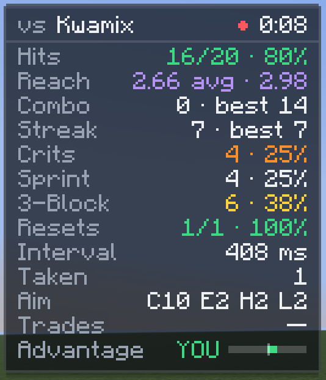</td>
    <td align="center" valign="top">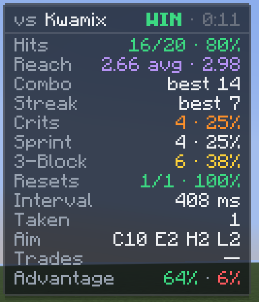</td>
    <td align="center" valign="top">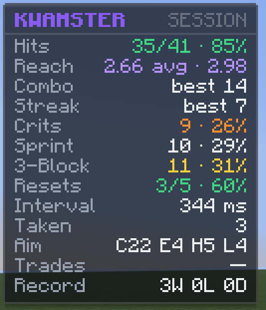</td>
  </tr>
  <tr>
    <td align="center"><em>During a fight: live numbers, red live dot and timer, advantage bar.</em></td>
    <td align="center"><em>Between fights (Last fight): the finished fight with its result and length.</em></td>
    <td align="center"><em>Between fights (Session totals): every counted fight this session and your record.</em></td>
  </tr>
</table>

A scoreboard-style panel in the top-left corner. These screenshots have every row switched on; at most 13 show at once, because Advantage shows during and after a fight and Record only in Session totals. By default it shows **8 rows**: Hits, Reach, Combo, Crits, Sprint, 3-Block, Resets and Advantage.

**When it shows**

- During a fight it shows that fight, live.
- Between fights it shows what **HUD → Panel outside a fight** says: **Last fight** (default, the last counted fight of this session), **Session totals**, or **Hidden**. Before your first counted fight it shows `KWAMSTER` and `No fights yet`.
- It is part of the "stats" output: **General → Stats output** set to **Chat only** hides it.

**The header**

| Scope | Left | Right |
|---|---|---|
| During a fight | `vs <opponent>` | a pulsing red `●` and the fight timer, e.g. `● 0:42` |
| Last fight | `vs <opponent>` | the result in bold and colour (**WIN** green, **LOSS** red, **DRAW** amber) and the length, e.g. `WIN · 0:42` |
| Session totals | `KWAMSTER` | `SESSION` |
| Nothing yet | `KWAMSTER` | (none), with one row `No fights yet` |

Long names are cut with `...`. The timer leaves out singleplayer pause time.

**The 14 rows** (choose them under HUD → Panel rows):

| Row | Default | Example | What it means | Colour |
|---|---|---|---|---|
| **Hits** | on | `23/31 · 74%` | Landed hits / swings at a player · accuracy | green at 70% or more, amber at 50% or more, red below |
| **Reach** | on | `2.84 avg · 2.99` | Average · longest reach of your landed hits (eye to the nearest point of their hitbox) | lavender when the longest is a 3-block distance |
| **Combo** | on | `3 · best 5` | Your current combo · your best combo this fight. Between fights only `best 5` | violet while a live combo is 3 or more |
| **Streak** | off | `4 · best 9` | Landed hits in a row without a missed swing · best streak | |
| **Crits** | on | `6 · 26%` | Charged critical hits · share of your landed hits | orange when you have any |
| **Sprint** | on | `12 · 52%` | Charged sprint hits (vanilla's extra-knockback hit) · share of landed hits | |
| **3-Block** | on | `4 · 17%` | Hits graded into the three 3-block tiers · share of landed hits | gold when you have any |
| **Resets** | on | `5/7 · 71%` | Successful jump resets / attempts · success rate | green at 60% or more, amber at 30% or more, red below |
| **Interval** | off | `548 ms` | Average time between two of your registered hits on the same opponent | |
| **Taken** | off | `14` | Melee hits you took (arrows and other projectiles are left out) | |
| **Aim** | off | `C12 E4 H5 L2` | Landed hits per aim zone: Centre, Edge, High, Low (10 000 or more shows as `12k`) | |
| **Trades** | off | `3W 1L` | Trades won and lost (a hit dealt and a hit taken within 400 ms; decided by damage, so it needs a server that shows health) | green when winning, red when losing |
| **Advantage** | on | `YOU` + bar | Who is ahead in the exchange right now: **YOU**, **EVEN** or **THEM**, with a bar that grows green to the right or red to the left. After the fight: the share of the fight each side was ahead, e.g. `62% · 21%`. Not shown in Session totals | YOU green, EVEN amber, THEM red |
| **Record** | on | `5W 2L 1D` | Wins, losses and draws this session (only in the Session totals view) | |

A dash `—` means "no data yet" (for example `Reach —` before your first landed hit). Every number is defined exactly in [How every number is calculated](#how-every-number-is-calculated).

**Other panel options** (HUD tab):

- **Compact panel** tightens the padding and lets the panel get narrower (minimum width 92 instead of 128 GUI pixels). Rows stay the same.
- **Flash values when they change** briefly shows a changed value in the accent colour, fading back over 0.3 s, so you notice what moved.
- **Accent**, **Panel background**, **Panel border**, **Values** and **Labels** colours.
- When the summary card appears on top of the panel (only on narrow screens), the panel fades out while the card shows and fades back afterwards.

### Hit indicator

<p align="center">
  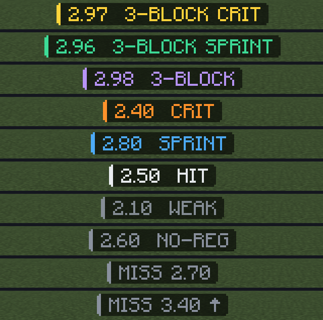
  <br><em>The hit indicator for each tier, top to bottom: 3-block crit, 3-block sprint, 3-block, crit, sprint, hit, weak, then a NO-REG hit, a miss, and an over-reach miss (↑).</em>
</p>

A small pill under your crosshair that shows the **latest** swing: its reach and its tier, in the tier's colour, e.g. `2.97  3-BLOCK CRIT`. It pops in, holds, and fades out over the last 0.25 s of its **Indicator duration** (default 0.8 s; Hit feedback tab). A new swing replaces it immediately.

| Pill | When |
|---|---|
| `2.97  3-BLOCK CRIT` and the other tiers | A landed hit, in its tier colour (see [Hit tiers](#hit-tiers)) |
| `2.60  NO-REG` (grey) | A landed hit into the target's hurt immunity, which the server most likely ignored (see [NO-REG hits](#no-reg-hits)) |
| `MISS 2.70` (grey) | A swing that missed the player it was aimed at, with the distance to them (Indicator: show misses) |
| `MISS 3.40 ↑` (grey) | A miss beyond your attack range: **over reach** |

Options: **Hit indicator** on/off, **Indicator duration**, **Indicator: show misses**, **Indicator: show reach** (off shows just the label). A tier you switch off shows no pill (NO-REG still shows).

### Combo counter

<p align="center">
  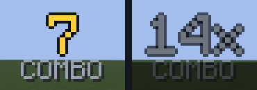
  <br><em>Left: a live 7-hit combo (gold from 6 hits). Right: a 14-hit combo just after it was broken, shown as a grey tally that fades out.</em>
</p>

A big number right of the crosshair that counts your current combo (your registered hits in a row before the opponent hits back; see [Combo](#combo-streak-and-advantage)).

- It appears once the combo reaches **Show combo counter from** (default **2** hits, up to 5).
- Colour: white for 2–3 hits, violet (accent) for 4–5, gold for 6 or more. Each new hit pops the number slightly.
- When the combo breaks (you get hit, 2 s pass without a hit, or the fight ends) the last number turns grey with a `×`, like `7×`, and fades out over 1 second.
- NO-REG hits never change it.
- **Combo counter** on/off in the HUD tab.

### Fight summary card

<p align="center">
  
  <br><em>The summary card after a won fight.</em>
</p>

When a fight ends, a card slides in at the top of the screen with the result and nine numbers. It shows for **7 seconds** (Fight alert → Show card for, 2–30 s) and fades out over the last 0.4 s (Fade out, 0–1.5 s). If a new fight starts while it is up, it fades away.

- **Header**: the result in bold (**WIN** green, **LOSS** red, **DRAW** amber), `vs <opponent>`, and the fight length on the right. A thin bar in the result colour runs along the top.
- **The nine cells**:

  | Cell | Meaning |
  |---|---|
  | **Acc** | Accuracy: landed hits / swings (green at 70%+, amber at 50%+, red below) |
  | **Reach** | Average reach of your landed hits |
  | **Max** | Your longest landed hit (lavender when it is a 3-block distance) |
  | **Crits** | Charged critical hits |
  | **3-Block** | 3-block hits (gold when you have any) |
  | **Sprint** | Charged sprint hits |
  | **Combo** | Your best combo |
  | **Resets** | Successful jump resets / attempts |
  | **Taken** | Melee hits you took |

- **Progress line**: the short violet line in the bottom-right corner shrinks as the card's time runs out.
- **Footer hint**: when the chat summary does **not** already carry the share link (for example with chat output off), the card adds a footer: `Saved · press [key] to share` if you bound **Copy last fight link**, `Saved` otherwise, or `Not saved` if the fight was not saved. With default settings the chat carries the link, so there is no footer.
- Only **counted** fights get a card: at least 3 swings plus hits taken, or any win or loss (see [Fights](#fights)).
- Options in the **Fight alert** tab: **Summary card**, **Show card for**, **Fade out**, **Footer hint**, and **Position card…** (opens the HUD editor with the card selected).

### Crosshair

<p align="center">
  
  <br><em>Left to right: default, on a player in reach, crit ready (falling), crit ready on a player.</em>
</p>

<p align="center">
  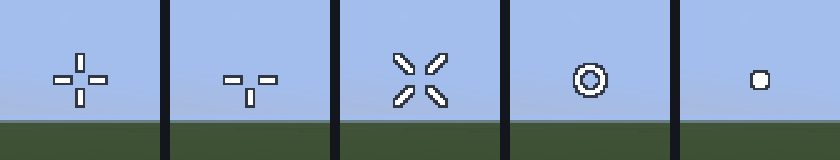
  <br><em>The five shapes: Cross, T, X, Circle and Dot.</em>
</p>

A crisp custom crosshair that tells you, at a glance, whether you can hit someone and whether your next hit would crit. It replaces only vanilla's crosshair image, so vanilla's rules still apply (first person only, vanilla's spectator-mode rule, F1, the F3 debug crosshair). It is drawn in real screen pixels, so it stays sharp at every GUI scale.

**States** (each colour can be changed):

| State | Default colour | When |
|---|---|---|
| **Default** | white | None of the below |
| **On a player in reach** | red | Your crosshair is on a player you can hit right now (vanilla only picks a target inside your attack reach). Spectators, dead players and NPCs do not count. With **Living mobs count as targets** on, any living mob counts too |
| **Crit ready** | cyan | Your next hit would be a critical hit: attack cooldown above 90%, falling (fall distance above 0), not on the ground, not climbing, not in water, not blinded, not riding anything, and **not sprinting** (vanilla's exact crit rule) |
| **Crit ready on a player** | pink | Both of the above: hit now for a crit |

**Hit flash**: when you land a registered hit, the crosshair briefly takes that hit's tier colour and its gap widens by up to 2 px, so the flash shows even when the colours match (Flash tier colour on hit, Flash duration 150 ms).

**Shape and size** (Crosshair tab): **Shape** (Cross, T, X, Circle, Dot), **Arm length / radius** (1–40 px; radius for Circle, diameter for Dot), **Gap** (0–20), **Thickness** (1–10), **Outline** (0–3 px, dark by default, never covering the fill), **Outline colour**, **Centre dot** (off or 1–10 px), and **Scale with GUI scale** (off keeps the same pixel size at every GUI scale).

**Vanilla attack indicator**: **Keep** (default) or **Hide** the attack-cooldown indicator vanilla draws under the crosshair when Options → Attack Indicator is set to Crosshair. The hotbar indicator is never touched.

Turn the custom crosshair off with **Custom crosshair** or the **Toggle custom crosshair** key to get the vanilla one back.

### Direction bars

<p align="center">
  
  <br><em>The direction bar above a player's head: moving forward (green), backpedalling (red), standing still (yellow). Shown here on the test player in third person.</em>
</p>

The bar from Direction Indicator, built in: a flat bar above every nearby player's head that shows which way they are moving **relative to where they are looking**.

| Colour | Meaning |
|---|---|
| **Green** | Moving forward (the way they are looking), e.g. walking or sprinting at you while facing you |
| **Red** | Moving backward: backpedalling, S-tapping |
| **Yellow** | Not meaningfully moving along their facing: standing still, or strafing sideways |

- It covers every player within **24 blocks** (Direction → Radius), alive and not spectating. Hub NPCs get one too, as in Direction Indicator.
- It sits just above the head and below the nametag, always faces you, and is drawn behind terrain rather than through it. F1 hides it.
- The movement is smoothed, so one dropped position update cannot flicker the colour, and teleports count as no movement.
- **Show above yourself** puts one over your own head too; you only see it in third person (F5). Handy for checking that the bars work.
- Under **Bar look**: the three colours and the dark **Backdrop** (as `#AARRGGBB`, the alpha is the opacity), **Movement threshold** (below 0.020 blocks per tick along their facing the bar is yellow; sneaking is about 0.065, walking 0.216, sprinting 0.280), **Width**, **Height** and **Height above head**.

### Jump sound

Also from Direction Indicator: a short cue the moment a nearby player starts a jump.

- It plays **from that player's position**, so you hear which direction they jumped in and it gets quieter with distance (the sound file is mono on purpose).
- It counts a jump once a player has left the ground and gained 0.1 blocks of height within 4 ticks, so walking off a ledge never plays it, and it cannot repeat within 6 ticks.
- **Knockback is not a jump.** A hit on a standing player launches them almost exactly like a jump, so after a player is hit, their next launch within **10 ticks** is ignored (Jump sound settings → Ignore knockback for, 0 turns this off); landing clears it. A jump made on the very tick of a hit (a jump reset) looks the same as knockback and is ignored too. Launches that deal no damage, such as wind charges and fishing rods, still play it.
- By default it does not play for your own jumps (Play for your own jumps).
- **Volume** 60% and **Pitch** 160% by default, on vanilla's Players volume slider; **▶︎ Test** plays it with your unsaved values (without the direction, so it sounds a little different from in game).
- It uses the same **Radius** as the bars (24 blocks). Minecraft fades positional sounds out over 16 blocks, so a jump farther away than about 16 blocks is too quiet to hear even inside the radius. Volume above 100% does not get louder; it stretches that fade distance instead (200% reaches 32 blocks).

### Opponent stoplight (optional)

<p align="center">
  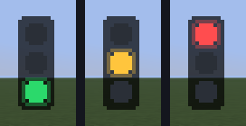
  <br><em>Approaching (green), holding distance or strafing (yellow), backing away (red).</em>
</p>

An optional on-screen traffic light, **off by default** (Direction → HUD stoplight → Opponent stoplight). Unlike the direction bars it measures your **opponent's movement toward or away from you**, whichever way they face:

| Light | Meaning |
|---|---|
| **Green** | The opponent is coming toward you (at least 1.0 block per second by default) |
| **Yellow** | Holding distance, standing, or strafing around you |
| **Red** | Backing away from you |

- **Whose movement**: your current fight opponent; with **Fight or aimed player** (default) also, outside a fight, the player you aim at within **Aimed player range** (8 blocks).
- **Approach/retreat threshold** (1.0 b/s), **Hysteresis** (once lit, a light holds until the speed drops 0.5 b/s below the threshold, so it does not flicker), **Smoothing** (150 ms), **Minimum hold** (a light stays at least 150 ms), **Ignore knockback for** (300 ms: after the opponent is hit the light holds instead of reading the knockback as retreating; it pulses while holding).
- **Style**: three lights **Vertical** (default), **Horizontal**, or a **Single light** in the active colour. **Show label and speed** writes `APPROACH +3.1`, `HOLD +0.2` or `RETREAT -2.4` (blocks per second) beside it. **Hide when nobody is tracked** (on) hides it when there is no target; off leaves the unlit light on screen at 40%.
- Four colours (approaching, holding, backing away, unlit) and **Position stoplight…**.

### HUD editor

<p align="center">
  
  <br><em>The HUD editor with its preview data. The stoplight is drawn faded and tagged "(off in settings)" because it is switched off.</em>
</p>

Every HUD element can be moved and resized. Open the editor with **Edit HUD layout…** (HUD tab), **Position card…** (Fight alert tab), **Position stoplight…** (Direction tab), or the **Edit HUD layout** key. While it is open the live HUD is hidden and every element shows fixed preview data; switched-off elements are drawn faded with the tag `(off in settings)`.

| Control | What it does |
|---|---|
| **Drag** | Moves an element. It snaps to the screen margins, the centre lines and the edges of other elements; accent guide lines show while snapped |
| **Shift + drag** | Moves without snapping |
| **Scroll** over an element | Resizes it, 50% to 300%, in steps that keep text pixel-sharp (½ at GUI scale 2, ⅓ at 3, ¼ at 4). The selection tag shows the scale, in the accent colour when it is sharp |
| **Shift + scroll** | Fine steps of 2.5% |
| **Right-click** an element | Resets it to its default place and size |
| **Arrow keys** | Nudge the selected element by 1 px (Shift: 10 px) |
| **R** | Resets the selected element |
| **G** | Toggles the 16 px grid |
| **Tab / Shift + Tab** | Cycles the selection |
| **Done** or **Esc** | Saves and closes |
| **Cancel** | Throws away your changes |
| **Reset all** | Click twice within 3 s: every element back to its default (saved on Done) |

Elements stay anchored to their nearest screen corner, edge or centre, so they keep their place when you change the GUI scale or window size. **Reset HUD layout** (HUD tab) resets everything immediately.

| Element | Default place |
|---|---|
| Stats panel | top left |
| Hit indicator | 26 px under the crosshair |
| Combo counter | 30 px right of the crosshair |
| Opponent stoplight | 30 px left of the crosshair |
| Summary card | top centre, 20 px down |

---

## Hit sounds

Every landed hit plays the sound of its tier, on top of vanilla's own hit sounds. **The 3-block crit and the 3-block sprint hit sound different**, so you know which one you landed without looking:

| Tier | Default sound | Volume / pitch | On by default |
|---|---|---|---|
| 3-block crit | `entity.experience_orb.pickup` (the XP orb) | 80% / 120% | yes |
| 3-block sprint | `block.note_block.pling` | 70% / 150% | yes |
| 3-block hit | `block.note_block.chime` | 60% / 140% | yes |
| Crit | `block.note_block.bell` | 55% / 120% | yes |
| Sprint hit | `block.note_block.hat` | 50% / 100% | yes |
| Normal hit | `block.note_block.snare` | 35% / 100% | **no** |
| Weak hit | `block.note_block.bass` | 40% / 60% | **no** |

- All ids are in the `minecraft:` namespace. Each tier's **Sound** switch, **Sound id** (any vanilla or resource-pack sound; the box suggests common ones), **Volume** and **Pitch** can be changed in the Hit feedback tab, and **▶︎ Test** plays your unsaved values.
- **Hit sounds** switches all tier sounds off at once. **Volume category** picks which vanilla volume slider scales them: **Players** (default), **Master** or **UI**. If you hear nothing, check that slider in Options → Music & Sounds.
- NO-REG hits play no sound, and a tier you switch off plays nothing.
- The only sound file in the mod is the [jump cue](#jump-sound); the tier sounds are vanilla's.

---

## Chat output

**General → Chat output** decides what is printed: **After each fight** (default), **Every hit**, **Both**, or **Off**. **General → Stats output** set to **HUD only** silences chat entirely. Every line starts with a violet `[KW]`, except lines 2 and 3 of the fight summary, which are indented under line 1.

### After each fight

<p align="center">
  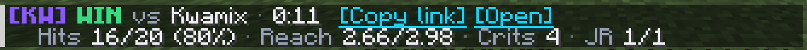
</p>

For every counted fight (see [Fights](#fights)):

- **Line 1** (always): `[KW] WIN vs Kwamix · 0:42  [Copy link] [Open]`
- **Line 2** (default on): `Hits 23/31 (74%) · Reach 2.84/2.99 · Crits 6 · JR 5/7` (JR = jump resets)
- **Line 3** (Fight summary lines set to 3): `Combo 5 · Streak 9 · Sprint 12 · 3-Block 4 · Taken 14`

**Fight summary lines** sets 1, 2 or 3 lines. **[Copy link]** copies the fight's [share link](#share-links-and-the-web-viewer) (hover it to see the link's length). **[Open]** opens it in your browser, through vanilla's Chat Links and Prompt on Links options. Turning off **Add [Copy link] [Open] to fight summary** removes the two buttons.

**Hover the result or lines 2 and 3 for every number:**

<p align="center">
  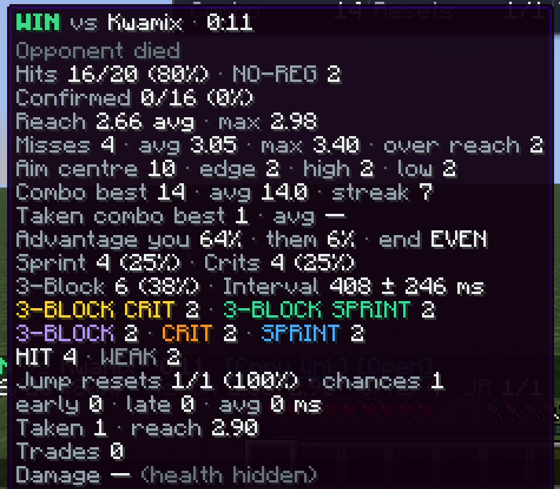
  <br><em>The full-stats tooltip (from a scripted test fight, so no server confirmations or health data).</em>
</p>

In order: the result line; other engaged opponents (`Also engaged …`); why the fight ended and your ping; hits and NO-REG hits; how many landed hits the server confirmed (and spear swings, if any); landed reach average and max; misses with their average and max reach and how many were over reach; aim zones; best and average combo and best streak; the opponent's best combo on you; advantage (share of time you and they were ahead, and who was ahead at the end); sprint hits and crits with their rates; 3-block hits and the hit interval (average ± spread); the count of each tier you landed, in its colour; jump resets with chances, early and late attempts and average timing; hits taken (and projectile hits) with the attackers' average reach; trades won, lost and even with trade win rate and momentum; damage dealt and taken (or `Damage — (health hidden)` when the server hides health).

### Every hit

<p align="center">
  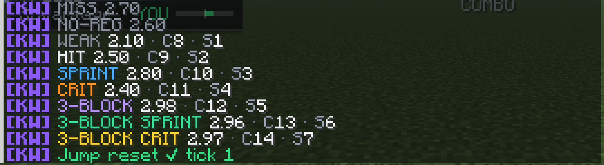
  <br><em>Chat output set to Every hit: a miss, a NO-REG hit, one hit of each tier from weak to 3-block crit, and a jump reset. (Chat draws over the HUD, so here it covers the bottom of the stats panel.)</em>
</p>

| Line | Example | Meaning |
|---|---|---|
| Landed hit | `[KW] 3-BLOCK CRIT 2.97 · C7 · S7` | Tier (in its colour) and reach, then your combo (`C`) and streak (`S`) after the hit |
| NO-REG hit | `[KW] NO-REG 2.60` | A hit into hurt immunity (grey) |
| Miss | `[KW] MISS 2.70` / `[KW] MISS 3.40 (over reach)` | A missed swing and its distance (Per-hit: include misses) |
| Jump reset | `[KW] Jump reset ✔ tick 1` | Success, or `✘ 1 tick early`, `✘ tick 4 · late` (Per-hit: include jump resets) |

<p align="center">
  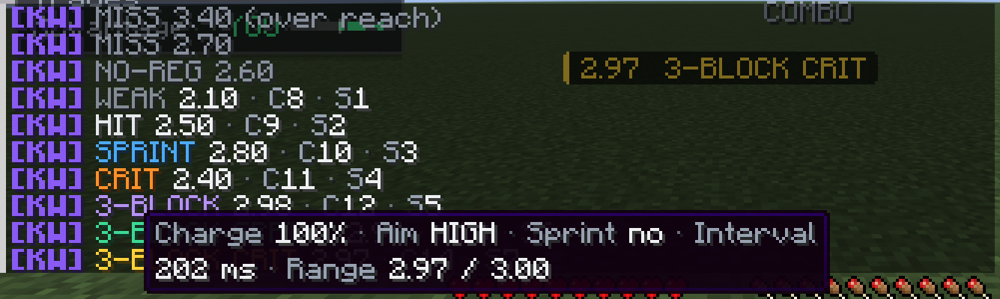
  <br><em>Hover a landed line for its details: charge, aim zone, sprint, interval since your previous hit, and reach against the server's attack range.</em>
</p>

Hovering a NO-REG line explains it; hovering a miss names who you missed; hovering a jump-reset line shows its wall-clock timing, who hit you, and the success window.

### Messages in the action bar

| Key | Message |
|---|---|
| Toggle HUD | `KWAMSTER HUD hidden` / `KWAMSTER HUD shown` |
| Toggle custom crosshair | `Custom crosshair ON` / `Custom crosshair OFF` |
| Copy last fight link | `Fight link copied (1234 chars)`, `No fight to share yet`, or `Share link unavailable (check the viewer URL in settings)` |

---

## Fights

Everything above is grouped into **fights**.

- **Start**: your first swing at a player (landed or missed), or the first melee hit you take from one, while no fight is running. Projectile hits never start a fight.
- **Engaged opponent**: a player you landed a hit on, or who hit you in melee. A player you only whiffed at is not engaged.
- **Keep-alive**: swings, hits and hits taken keep the fight going. Arrows and other projectile hits from or on an engaged opponent, and spear stabs at them, keep it alive too.
- **End and result**:

  | The fight ends when | Result |
  |---|---|
  | An engaged opponent dies | **WIN** |
  | You die | **LOSS** |
  | An engaged opponent switches to spectator within 3 s of your last hit | **WIN** |
  | You switch to spectator within 3 s of the last hit you took | **LOSS** |
  | The opponent leaves, is no longer tracked, or turns spectator later | DRAW |
  | The opponent is more than 16 blocks away | DRAW |
  | 8 seconds pass with no combat | DRAW |
  | You disconnect, change world or dimension, or respawn | DRAW |
  | You close the game, or turn KWAMSTER off mid-fight | DRAW |

  The 3 s, 16 block and 8 s values are Advanced settings. If both players die, the first death seen decides. If a bystander you only whiffed at dies to someone else, that is a DRAW, never a WIN.
- **Counted fights**: a fight gets the summary card and the chat summary, and joins your session and lifetime totals, when it has at least **3** swings plus melee hits taken (Advanced → Minimum events), or when it is a WIN or LOSS. Shorter draws (a stray click in a lobby) are still saved unless you turn that off, but are not announced. A fight that ends because you disconnected is saved without a card or chat line.
- **Duration** runs from the first event to the last combat event (or the death), so idle time at the end is not counted. Singleplayer pauses are excluded.
- **Several opponents**: a 1v2 is one fight. The stats cover everyone; the primary opponent is the engaged one you exchanged the most hits with, and the others are listed as "Also engaged" and `+N`.
- **Settings snapshot**: the 3-block reach, jump windows, combo timeout, advantage window and interval gap are copied when a fight starts, so changing them applies from the next fight.

---

## Saved fights

<p align="center">
  
  <br><em>The Saved fights screen with the newest fight selected.</em>
</p>

Every fight is saved on your computer (Recording & sharing → Save every fight). Open the list with **Saved fights…** (Recording & sharing tab) or the **Saved fights** key.

- **Header**: your lifetime totals of counted fights, e.g. `132 fights · 78W 41L 13D · 71% acc · since Oct 20` (since when lifetime tracking started).
- **Each row**: a strip in the result colour, the result and opponent (`WIN vs Kwamix`, with `+N` for extra opponents and a gold `★` when pinned), and a second line with the date and time, length, accuracy, average reach and best combo, e.g. `Oct 20 15:30 · 0:42 · 74% · 2.84 · combo 5`.
- Newest first. The list updates by itself when a fight is saved while it is open.

| Button | What it does |
|---|---|
| **Copy link** | Copies the selected fight's share link (shows `Copied ✔`) |
| **Open** | Opens the selected fight in the web viewer |
| **Pin / Unpin** | Pinned fights are never deleted to make room |
| **Delete** | Click twice within 3 s to delete the selected fight's file for good |
| **Open folder** | Opens `config/kwamster/fights` in your file manager |
| **Done** | Back to the game or the previous screen |

**Keeping the list tidy**: **Saved fights to keep** (default 500, 0 = unlimited; pinned fights do not count toward it). Above the limit the oldest unpinned fights are deleted, short uncounted fights first, so a stray click in a lobby never pushes out a real fight. **Also save fights below the minimum events** (on) decides whether those short fights are saved at all.

---

## Share links and the web viewer

After a fight, click **[Copy link]** or **[Open]** in the chat summary, or use the Saved fights screen, the **Copy last fight link** key, or **Copy last fight link** in the Recording & sharing tab. The link opens the fight in the viewer at <https://builtdoor1.github.io/kwamster/>.

**What a link contains**

- Your name and your opponents' names (up to four).
- The server name, if **Include server name** is on. Numeric IP addresses are always left out.
- When the fight started (to the second), its duration, result and end reason, and your ping.
- The thresholds used: 3-block reach, jump windows, combo timeout and advantage window.
- The summary numbers (exact).
- A list of events: time, hit, miss, hit taken, jump or death, reach, aim offset, tier, NO-REG flag and jump timing.
- If **Include positions for the replay** is on: your position relative to where the fight started, and each opponent's direction and distance from you.

**What it never contains**: world coordinates, IP addresses, UUIDs, or anything outside the fight.

**Nothing is uploaded.** The fight is compressed into the part of the link after `#`. Browsers never send that part to any server, and the viewer is a single self-contained page that makes no network requests (no fonts, no player heads, no analytics). It unpacks the link in your browser.

Links are kept within **1900 characters** by default, which fits one Discord message (Recording & sharing → Max link length, 600 to 8000). For long fights the event list is thinned to fit, and the viewer says how many events the replay shows. If that is still too long, positions are dropped (the replay then shows the distance between you over time), then the server name, and names are shortened; if nothing fits, the shortest version is used. The summary numbers always stay exact.

### The viewer, section by section

<p align="center">
  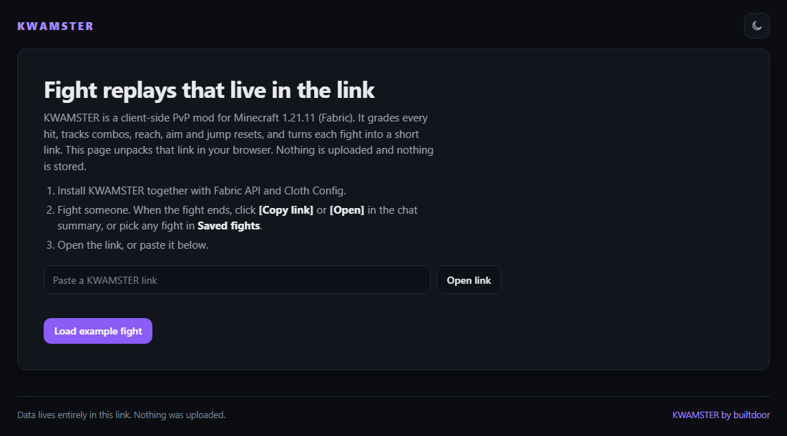
  <br><em>The start page: paste a link, or load the example fight.</em>
</p>

**Header and stat cards**

<p align="center">
  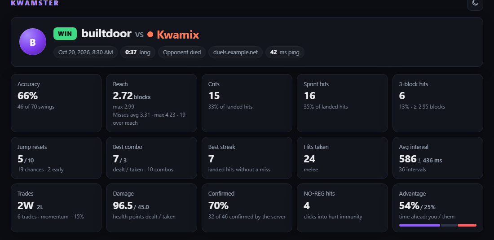
</p>

The header shows the result, both names (opponents in their own colours), and chips with the date and time, length, how the fight ended, the server and your ping. Every card has a tooltip:

| Card | Shows |
|---|---|
| **Accuracy** | Landed swings out of every swing at a player |
| **Reach** | Average and longest landed reach, plus your misses' average and longest distance and how many were over reach |
| **Crits** | Charged critical hits, and their share of landed hits |
| **Sprint hits** | Charged sprint hits (the extra-knockback hit), and their share |
| **3-block hits** | Hits landed from at least the 3-block threshold, and their share |
| **Jump resets** | Successful resets / attempts, chances (melee hits taken on the ground) and early attempts |
| **Best combo** | Your longest combo / theirs, and how many combos there were |
| **Best streak** | Most landed hits in a row with no miss |
| **Hits taken** | Melee hits you took, plus projectile hits |
| **Avg interval** | Time between consecutive registered hits on the same opponent (average ± spread) |
| **Trades** | Simultaneous exchanges won and lost by damage, and momentum |
| **Damage** | Health points dealt and taken (only when the server showed health) |
| **Confirmed** | Landed hits the server answered with a damage event |
| **NO-REG hits** | Clicks into hurt immunity |
| **Advantage** | Share of the fight you or they were ahead, with a you / even / them bar |

**Timeline**

<p align="center">
  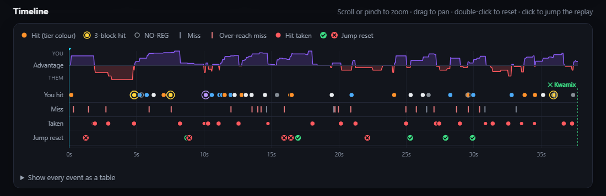
</p>

Every event on one time axis: the advantage line on top (violet above the middle when you were ahead, red below when they were), then lanes for **You hit** (dots in tier colours, a ring for 3-block hits, hollow for NO-REG), **Miss** (red for over reach), **Taken** and **Jump reset** (✔ or ✘), with deaths as dashed lines. **Scroll or pinch** to zoom, **drag** to pan, **double-click** to reset, **click** an event to jump the replay there, hover anything for details. With the keyboard: ←/→ step through events, `+`/`-` zoom, `0` resets. **Show every event as a table** lists them all with time, event and detail.

**Replay**

<p align="center">
  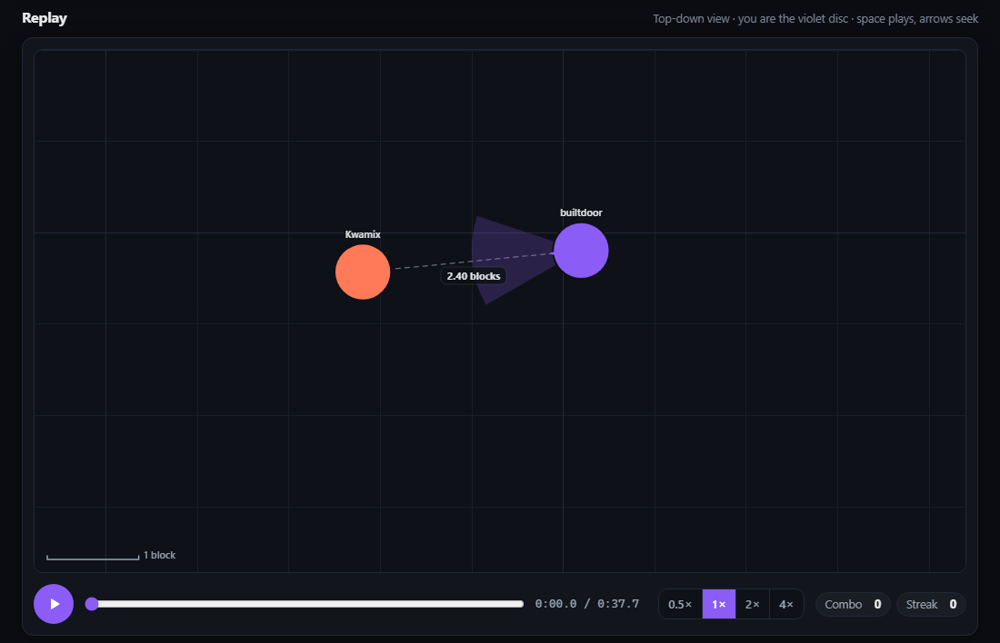
</p>

A top-down replay of the fight: you are the violet disc, each opponent its own colour, with fading trails, a dashed distance line and a scale bar. Hits burst as rings with their tier pill (`2.97 3-BLOCK CRIT`), misses as dashed arcs, hits taken as red rings, jump resets as `JR ✔`/`JR ✘`, deaths as an ×. Play, pause and scrub, at 0.5×, 1×, 2× or 4×; live **Combo** and **Streak** chips count along. **Space** or **K** plays, ←/→ seek one second (Shift: five). Links made with positions off show the distance between you over time instead.

**Aim map and reach**

<p align="center">
  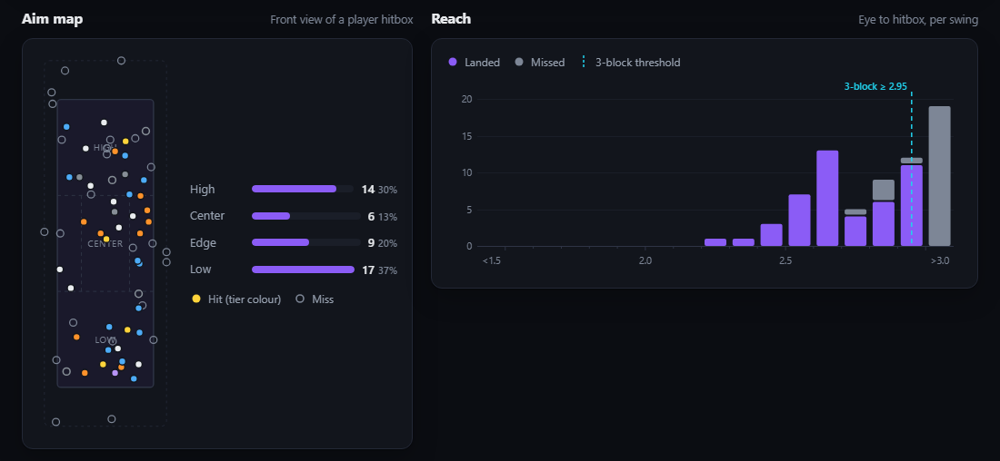
</p>

The **aim map** is a front view of a player's hitbox with every hit where it landed (tier colours) and every miss around it, plus the high / centre / edge / low counts. The **reach histogram** shows landed and missed swings in 0.1-block bins with the 3-block threshold marked.

**Hit quality and jump resets**

<p align="center">
  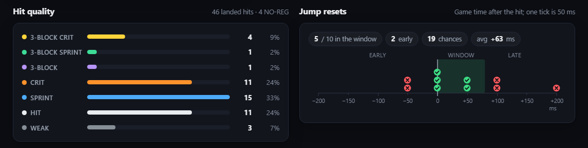
</p>

**Hit quality** counts each tier. **Jump resets** plots every attempt by its timing in game ticks (one tick = 50 ms) against the success window, with early and late attempts on either side.

**Other details**

- Light and dark themes (the moon/sun button; dark by default, remembered in your browser).
- **Browser support**: Chrome or Edge 103+, Firefox 113+, Safari 16.4+, phones included. Older browsers get a clear message instead of a broken page, and a damaged or cut-off link gets an explanation instead of a crash.

### Hosting your own viewer

Links open the page set in **Recording & sharing → Viewer URL** (default `https://builtdoor1.github.io/kwamster/`). The viewer is the single file [`docs/index.html`](docs/index.html), so any static host works. With GitHub:

1. Fork this repository.
2. In your fork, go to **Settings → Pages**, choose **Deploy from a branch**, branch `main`, folder `/docs`, and save.
3. Set Viewer URL to your Pages address, for example `https://<you>.github.io/kwamster/`.

A trailing `/` is added unless the URL ends in a file name or has a query. Links you shared earlier keep pointing at the address they were made with, and work only while that site serves the viewer.

---

## How every number is calculated

### What counts as a swing

A swing is an attack click that passes vanilla's own attack checks, made while you are not a spectator, and aimed at a player:

- If your crosshair is on a player, the swing targets them.
- If it is on nothing or a block, the swing counts as a **miss** against the living player nearest your crosshair within a 30° cone and 6 blocks (Advanced → Miss target cone / range). With nobody there, the swing is ignored.
- Clicks on mobs, end crystals, armour stands, NPCs or a body that just died are not counted at all.
- Clicks during the attack cooldown are real swings; if they land they are weak hits.

**Landed** means your client actually sent the attack. **Accuracy** = landed / swings. **Confirmed** means the server sent back a damage event for that hit (matched within your ping + 300 ms); it is shown in the chat hover and the viewer.

### Reach

- Reach = distance from your eyes to the **nearest point of the target's hitbox** at the moment you attack, measured on tick positions. This is the distance the server checks.
- With vanilla attributes, landed reach is always below 3.00, because the client only picks a player inside 3 blocks.
- Missed swings record the same distance to the player you swung at. A miss farther than your attack range (3.0 in vanilla) is **over reach** (shown with ↑).
- Displayed reach is **rounded down** to two decimals everywhere, so a shown 2.95 really is at least 2.95. The one exception is an over-reach miss: it always reads at least 0.01 above your range (a 3.004-block miss shows `MISS 3.01 (over reach)`, never 3.00).
- If a server gives an item its own attack range, reach is still recorded but the hit is never graded as a 3-block hit.

### Hit tiers

Each landed hit gets the first tier that matches:

1. Not charged (attack cooldown at 90% or less): **WEAK**.
2. A **crit** that is also a 3-block hit: **3-BLOCK CRIT**, otherwise **CRIT**.
3. A **sprint hit** that is also a 3-block hit: **3-BLOCK SPRINT**, otherwise **SPRINT**.
4. Any other charged hit (plain hits and sweeps): **3-BLOCK** or **HIT**.

| Tier | Label | Colour |
|---|---|---|
| 3-block crit | `3-BLOCK CRIT` | gold `#FFD43B` |
| 3-block sprint | `3-BLOCK SPRINT` | mint `#3DDC97` |
| 3-block hit | `3-BLOCK` | lavender `#B794F6` |
| Crit | `CRIT` | orange `#FF922B` |
| Sprint hit | `SPRINT` | blue `#4DABF7` |
| Normal hit | `HIT` | white `#E9ECEF` |
| Weak hit | `WEAK` | grey `#868E96` |

- **3-block hit** ("perfect" hit) = a charged hit with reach **≥ 2.95 blocks**, eye to nearest hitbox point. Adjustable from 2.50 to 3.00 under Hit feedback → 3-block reach.
- **Sprint hit** = **charged and sprinting** at the moment of the hit, the hit vanilla gives extra knockback. An uncharged hit while sprinting is not a sprint hit, so spam-clicking while sprinting does not inflate the count. Sprint % = sprint hits / landed hits.
- **Crit** = charged and vanilla's crit condition, verbatim: falling (fall distance above 0), not on the ground, not on a ladder or vine, not in water, not blinded, not riding anything, not sprinting. Because a crit needs "not sprinting", a hit is never both a crit and a sprint hit.
- **Crit rate** = crits / **all landed hits**, weak hits included.
- **3-block %** = 3-block hits / landed hits.
- Each tier's label (up to 16 characters), colour and sound can be changed, and a tier can be switched off: it then shows no indicator, flash, sound or chat line, but the hit is still recorded.

### NO-REG hits

A landed hit is flagged **NO-REG** when the target is most likely still in hurt immunity, so the server ignores it:

- fewer than **10 ticks** (0.5 s) after your last registered hit on the same player, or
- while that player is still immune from someone else's damage (estimated from their hurt timer and your ping).

A landed hit that is not NO-REG is called a **registered** hit below.

NO-REG hits **count** for swings, landed, accuracy, reach, aim, tiers, crits and sprint hits. They **do not** add to or break your combo or streak, are left out of hit intervals and the advantage bar, play **no sound**, give no crosshair flash, and show a grey `NO-REG` indicator. The window is **Advanced → NO-REG immunity window** (0 to 20 ticks, default 10). Set it to 0 (off) on combo servers with a reduced hit delay.

### Jump resets

- A **chance** is a melee hit you take **while on the ground**. Hits taken in the air open no window (they cannot be reset). Bow, crossbow, trident, snowball, egg, wind charge and fishing-rod hits, and thorns, never count.
- An **attempt** is a jump (or a jump-key press) up to **200 ms** of game time (5 ticks) after a chance, or up to 200 ms **before** a hit (an early attempt).
- Pressing jump just before you land and **holding** it is the classic timing: the game jumps on your first tick on the ground, so if the hit lands right then it counts as the jump it makes (a success), not as an early press. A press you let go of before the hit, or before that first tick, is early.
- Timing is counted in client ticks, one tick = 50 ms of game time, where **0 ms = the first tick after the hit**:

  | When you jump | Result |
  |---|---|
  | Tick 1 or 2 after the hit (0 or 50 ms) | success |
  | Tick 3 to 5 (100 to 200 ms) | late |
  | Before the hit landed | early |

- Jump % = successes / attempts. The panel shows `5/7 · 71%`; the chat hover and the viewer add chances and early attempts.
- The windows are Advanced → Reset success from / …to (default 0 to 80 ms) and Jump counts as an attempt within (default 200 ms). Because they are game ticks, results are the same at 60 and 240 FPS.

### Combo, streak and advantage

- **Combo** = your registered hits in a row before the opponent lands a melee hit on you. It also ends when your next hit comes more than **2 s** after the last one (Advanced → Combo timeout, 0 = never) and when the fight ends. Misses do not break it. Best combo is the longest; a "combo" in the counts is a chain of 2 or more. The same is tracked for hits you take in a row.
- **Streak** = landed hits in a row without a missed swing. Hits you take do not break it, and NO-REG hits neither count nor break it.
- **Advantage** looks at the last **3 s** (Advanced → Advantage window). With d = your registered hits and k = melee hits you took in that window: exchange = (d − k) / max(d + k, 1). A combo term adds min(your combo, 3)/3 when you hold a combo and they do not (or subtracts the same for theirs). Advantage = ½ · combo term + ½ · exchange, from −1 to +1. The label reads **YOU** at +0.15 or more, **THEM** at −0.15 or less, else **EVEN**. After a fight it becomes the share of time (sampled every 100 ms) that each side was ahead.

### Aim zones

The hit point is where your crosshair ray entered the target's hitbox, using the hitbox's real pose (shorter when sneaking, crawling or swimming). One zone per landed hit, first match wins:

- **High**: top third of the hitbox height.
- **Low**: bottom third.
- **Edge**: the outer quarter of the width on either side.
- **Centre**: everything else.

### Hit timing

Interval = time between two consecutive registered hits on the same opponent, measured from your attack-key press (frame-accurate) when one was seen within 200 ms of the attack. Gaps over 2 s (Advanced → Interval max gap) are left out. Shown as average ± standard deviation.

### Trades and damage

- A **trade** is one hit dealt and one melee hit taken between the same two players within **400 ms** (Advanced → Trade window). It is won or lost by the health each side lost, so trades are decided only on servers that show health; even trades and trades with unknown damage are left out of the win/loss count.
- **Damage dealt and taken** are filled in only when the server shows health (health drops from 0.1 s before to 0.9 s after a hit). Otherwise they show "—".

### NPCs, spears and other exclusions

- **NPCs**: a player missing from the tab list, or with a version-2 UUID (used by Citizens and most NPC plugins), is treated like a mob: never a target, attacker or fight. This stops hub queue NPCs from creating fights. Turn it off under Advanced → Ignore NPCs if a server hides real players from the tab list.
- **Spears**: spear attacks are counted separately and kept out of swings, accuracy, reach and tiers, because the client never learns whether a stab landed. They still keep a fight alive.
- **Thorns** is ignored both ways.

---

## Settings, tab by tab

Open the settings with **K** or with the Mod Menu **Config** button. Every setting has a tooltip and a **Reset** button (buttons have a tooltip only); greyed-out entries depend on a switch above them. Nothing changes until you press **Save & Quit**; **Cancel** throws the changes away (except the few buttons listed under [Saving, cancelling and errors](#saving-cancelling-and-errors)).

Toggles read **Yes** (green) / **No** (red). Colours are typed as `#AARRGGBB`: the first two digits are the opacity (`ff` solid, `00` invisible). Collapsed groups (marked **+**) open when you click their header.

### General

<p align="center">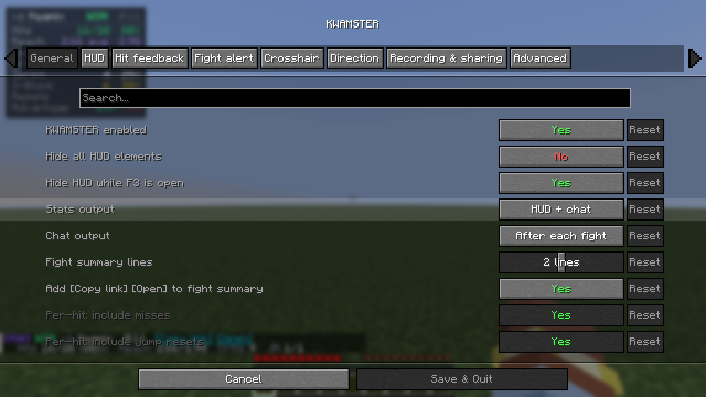</p>

| Setting | Default | Choices | What it does |
|---|---|---|---|
| KWAMSTER enabled | Yes | Yes / No | The master switch. Off: no HUD, custom crosshair, bars, sounds, chat lines or new fights; the game is pure vanilla |
| Hide all HUD elements | No | Yes / No | Hides every KWAMSTER HUD element; fights are still tracked. The Toggle HUD key flips this too |
| Hide HUD while F3 is open | Yes | Yes / No | Hides the KWAMSTER HUD while the F3 debug screen is shown |
| Stats output | HUD + chat | HUD only / Chat only / HUD + chat | Controls the stats panel and the chat output only (the card, indicator, combo counter and stoplight have their own switches) |
| Chat output | After each fight | Off / After each fight / Every hit / Both | When KWAMSTER prints to chat. Greyed out with Stats output = HUD only |
| Fight summary lines | 2 lines | 1 / 2 / 3 lines | 1: result and link. 2: adds hits, reach, crits and jump resets. 3: adds combo, streak, sprint, 3-block and hits taken |
| Add [Copy link] [Open] to fight summary | Yes | Yes / No | The clickable link buttons on the summary line |
| Per-hit: include misses | Yes | Yes / No | With per-hit chat, also print a line for each missed swing |
| Per-hit: include jump resets | Yes | Yes / No | With per-hit chat, also print a line for each jump-reset attempt, with how many game ticks after the hit you jumped |

### HUD

<p align="center">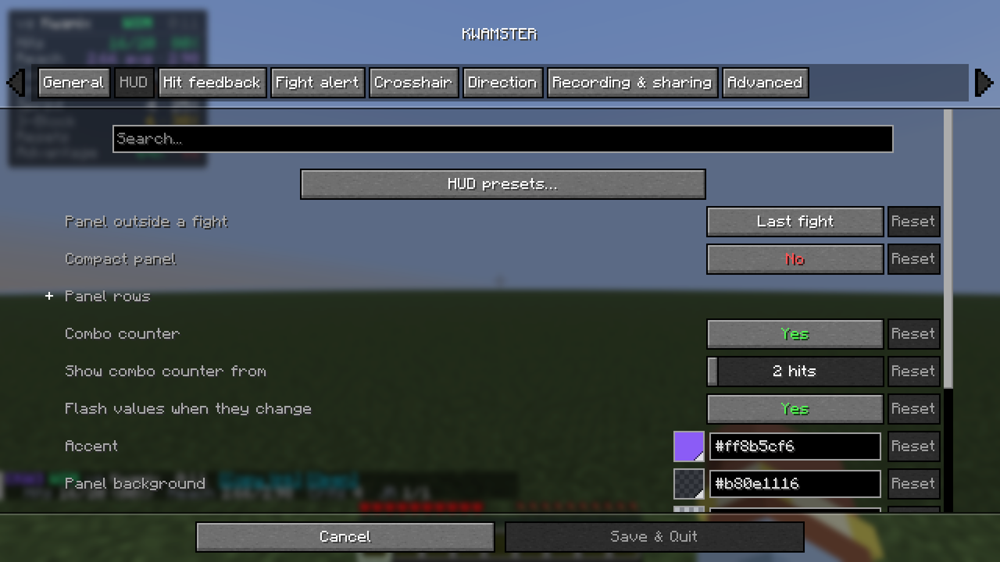</p>

| Setting | Default | Choices | What it does |
|---|---|---|---|
| Panel outside a fight | Last fight | Last fight / Session totals / Hidden | What the stats panel shows between fights |
| Compact panel | No | Yes / No | Tighter padding and a narrower minimum width |
| **+ Panel rows** | | 14 switches | Which rows the panel shows, in this order (below) |
| Combo counter | Yes | Yes / No | The big combo number next to the crosshair |
| Show combo counter from | 2 hits | 2 – 5 hits | The counter appears once your combo reaches this |
| Flash values when they change | Yes | Yes / No | A changed panel value briefly lights up in the accent colour |
| Accent | `#ff8b5cf6` | colour | Titles, highlights and the HUD editor selection |
| Panel background | `#b80e1116` | colour | Panel background; lower opacity shows more of the world |
| Panel border | `#26ffffff` | colour | 1 px border of the panel and card; opacity `00` hides it |
| Values | `#fff1f3f5` | colour (opacity at least `20`) | Colour of the numbers |
| Labels | `#ff9aa4b2` | colour (opacity at least `20`) | Colour of the row labels |
| *Edit HUD layout…* | button | | Opens the [HUD editor](#hud-editor) |
| *Reset HUD layout* | button | | Puts every element back in its default place and size, and saves right away (no confirmation) |

<p align="center">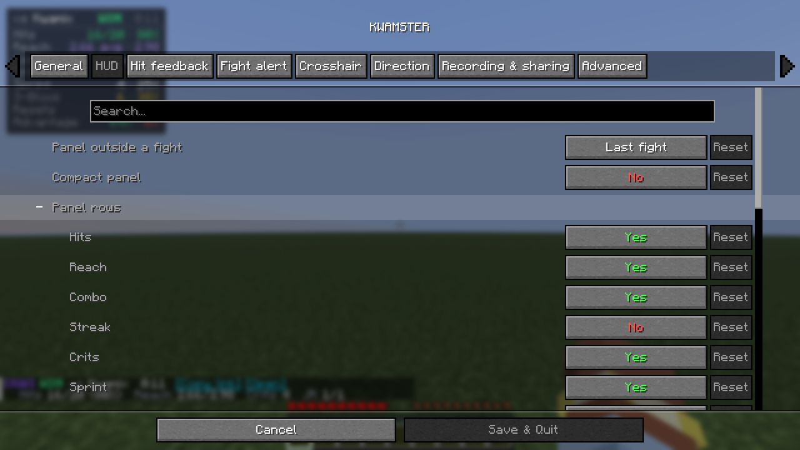</p>

**Panel rows**: Hits (Yes), Reach (Yes), Combo (Yes), Streak (No), Crits (Yes), Sprint (Yes), 3-Block (Yes), Resets (Yes), Interval (No), Taken (No), Aim (No), Trades (No), Advantage (Yes), Record (Yes, shown only with session totals). What each row means is in the [panel's row table](#stats-panel).

### Hit feedback

<p align="center">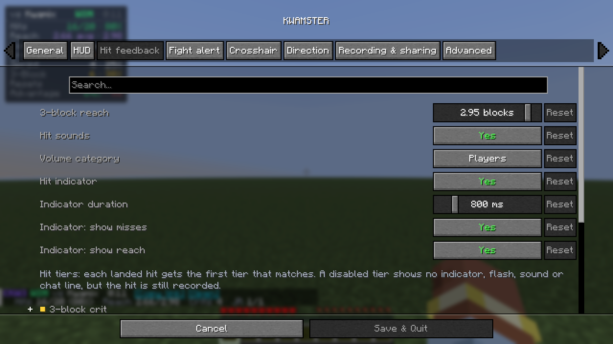</p>

| Setting | Default | Choices | What it does |
|---|---|---|---|
| 3-block reach | 2.95 blocks | 2.50 – 3.00 blocks | A charged hit is a 3-block hit when the distance from your eyes to the nearest point of the target's hitbox is at least this. Applies from the next fight |
| Hit sounds | Yes | Yes / No | Plays the tier's sound when you land a hit (NO-REG hits stay silent). Each tier also has its own sound switch |
| Volume category | Players | Master / Players / UI | Which vanilla volume slider (Options → Music & Sounds) scales the hit sounds. Players and UI are also scaled by Master Volume |
| Hit indicator | Yes | Yes / No | The pill under the crosshair |
| Indicator duration | 800 ms | 300 – 3000 ms | How long the pill stays after a hit |
| Indicator: show misses | Yes | Yes / No | Also show `MISS` and the distance when a swing misses |
| Indicator: show reach | Yes | Yes / No | Show the reach before the tier label |

Then one collapsed group per tier (**■ 3-block crit**, **■ 3-block sprint**, **■ 3-block hit**, **■ Crit**, **■ Sprint hit**, **■ Normal hit**, **■ Weak hit**; the square shows the tier's colour):

<p align="center">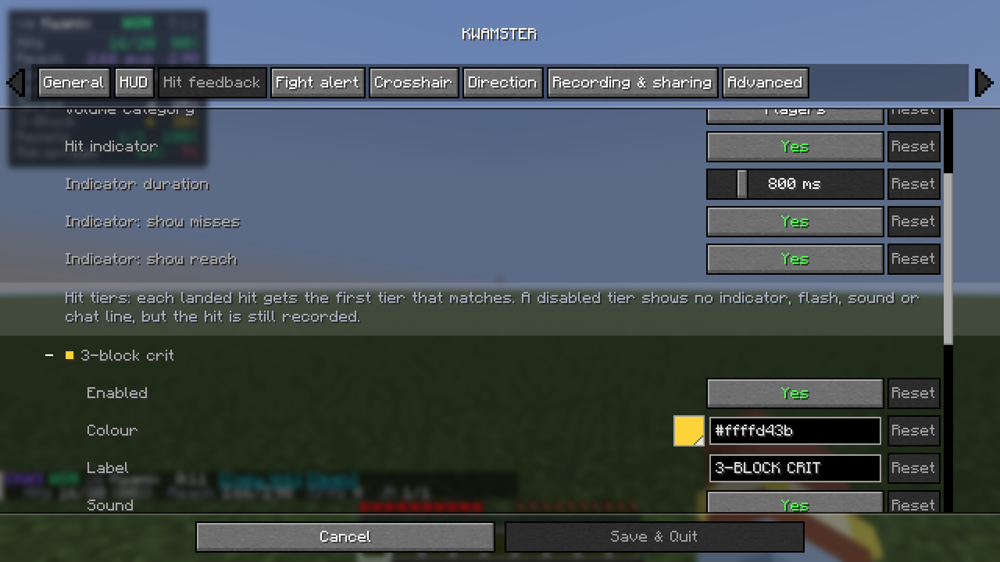</p>

| Setting | Choices | What it does |
|---|---|---|
| Enabled | Yes / No | Off: no indicator, crosshair flash, sound or per-hit chat line for this tier. The hit is still recorded and counted |
| Colour | colour (opacity at least `20`) | Indicator, crosshair flash and chat colour |
| Label | 1 – 16 characters | Text on the indicator and the per-hit chat line |
| Sound | Yes / No | Play this tier's sound (Hit sounds must be on too) |
| Sound id | pick from the list, or type any id | Any vanilla or resource-pack sound. The list suggests 26: the XP orb, every note block instrument except the didgeridoo, the amethyst chime and hit, the arrow-hit "ding", item pickup, level-up, four of the player attack sounds (crit, strong, knockback, weak) and the button click. An id the game does not know shows a gold "Unknown sound (resource pack?)" warning |
| Volume | 0 – 100% | Playback volume, further scaled by the Volume category slider |
| Pitch | 50 – 200% | 100% is the sound's normal pitch, lower is deeper |
| ▶︎ Test | button | Plays the sound with these values, including unsaved changes. Warns `Volume is 0%`, `Master Volume is 0%`, `Players volume is 0%` or `UI volume is 0%` when you would hear nothing, and shows `Invalid sound id` or `Unknown sound` for a bad id |

The defaults of every tier are in [Hit sounds](#hit-sounds) and [Hit tiers](#hit-tiers).

### Fight alert

<p align="center">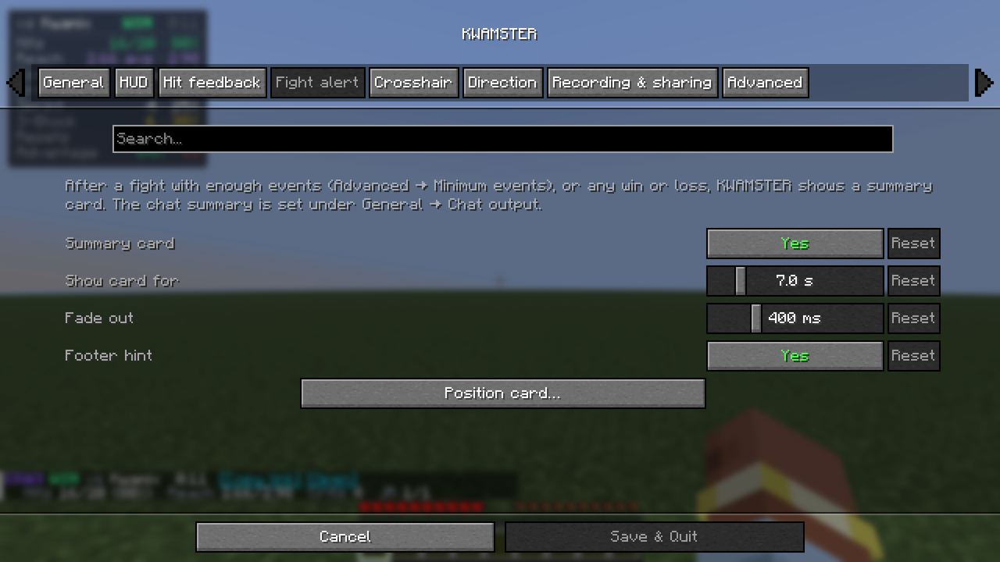</p>

| Setting | Default | Choices | What it does |
|---|---|---|---|
| Summary card | Yes | Yes / No | The card with the fight's result and key numbers |
| Show card for | 7.0 s | 2.0 – 30.0 s | How long the card stays on screen |
| Fade out | 400 ms | 0 – 1500 ms | Length of the fade at the end; 0 hides it at once |
| Footer hint | Yes | Yes / No | A footer saying how to share the fight, shown only when the chat summary does not already offer the link |
| *Position card…* | button | | Opens the HUD editor with the card selected |

### Crosshair

<p align="center">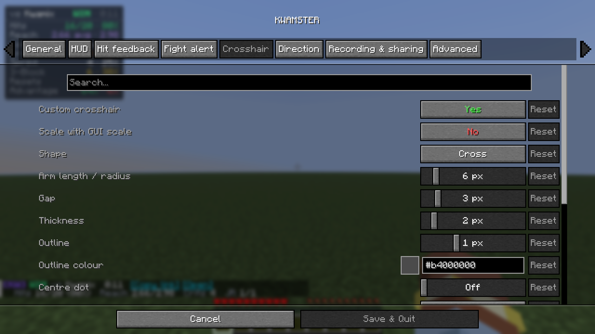</p>

| Setting | Default | Choices | What it does |
|---|---|---|---|
| Custom crosshair | Yes | Yes / No | KWAMSTER's crosshair; off gives vanilla's. The Toggle custom crosshair key flips this too |
| Scale with GUI scale | No | Yes / No | Sizes are screen pixels; turn this on to grow them with the GUI scale (for 4K screens) |
| Shape | Cross | Cross / T / X / Circle / Dot | Four arms, T (no top arm), diagonal X, ring, or solid dot |
| Arm length / radius | 6 px | 1 – 40 px | Arm length; the radius for Circle, the diameter for Dot |
| Gap | 3 px | 0 – 20 px | Space between the centre and each arm |
| Thickness | 2 px | 1 – 10 px | Width of the arms and of the ring |
| Outline | 1 px | None, 1 – 3 px | Border for contrast on any background |
| Outline colour | `#b4000000` | colour | Colour of the outline |
| Centre dot | Off | Off, 1 – 10 px | A square dot in the middle |
| Vanilla attack indicator | Keep | Keep / Hide | Only matters when Options → Attack Indicator is set to Crosshair |
| Colour: default | `#ffffffff` | colour | When none of the states below applies |
| Colour: on a player in reach | `#ffff4d4d` | colour | While you aim at a player close enough to hit right now |
| Colour: crit ready (falling) | `#ff38d9ff` | colour | While falling with a charged attack and not sprinting, so the next hit would crit |
| Colour: crit ready on a player | `#ffff6bd6` | colour | Both of the above |
| Living mobs count as targets | No | Yes / No | Also use the on-a-player colours on mobs |
| Flash tier colour on hit | Yes | Yes / No | Briefly shows the hit tier's colour and widens the gap |
| Flash duration | 150 ms | 0 – 600 ms | How long the hit flash lasts |

### Direction

<p align="center">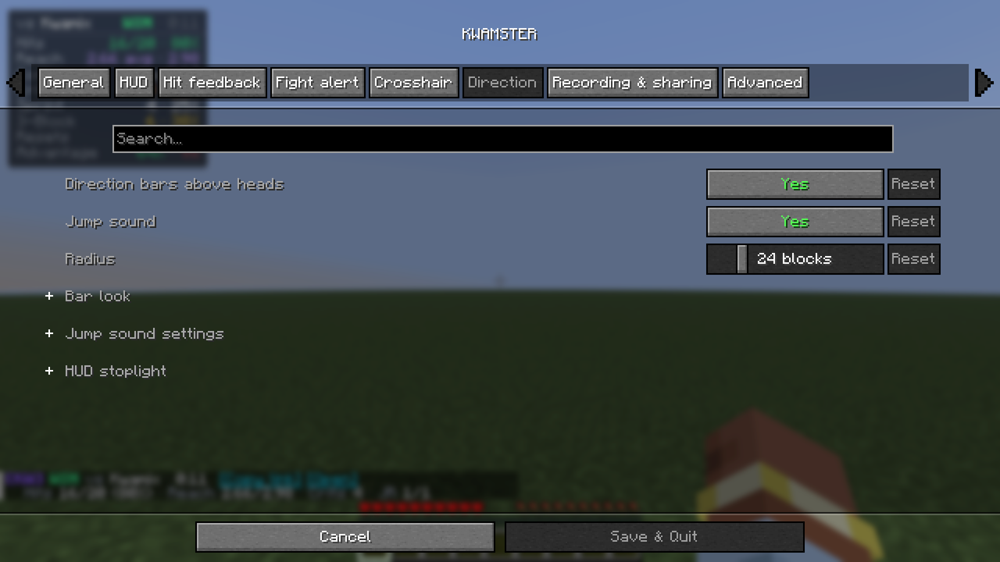</p>

| Setting | Default | Choices | What it does |
|---|---|---|---|
| Direction bars above heads | Yes | Yes / No | The [direction bars](#direction-bars) |
| Jump sound | Yes | Yes / No | The [jump cue](#jump-sound) |
| Radius | 24 blocks | 1 – 128 blocks | Players farther away get no bar and no jump sound |

<table>
  <tr>
    <td align="center" valign="top">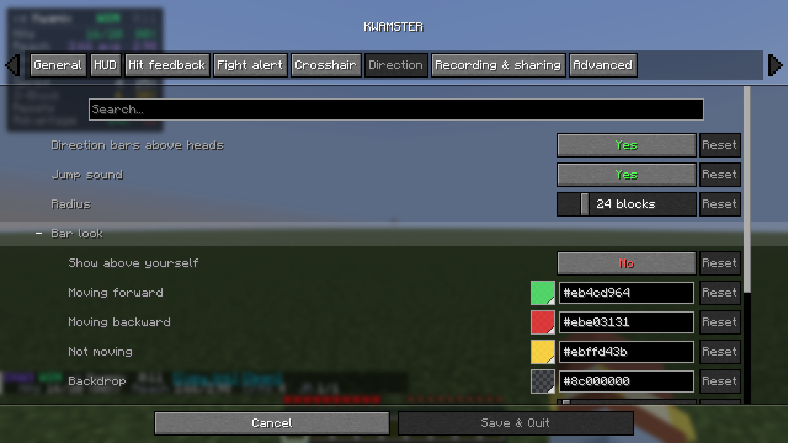<br><em>+ Bar look</em></td>
    <td align="center" valign="top">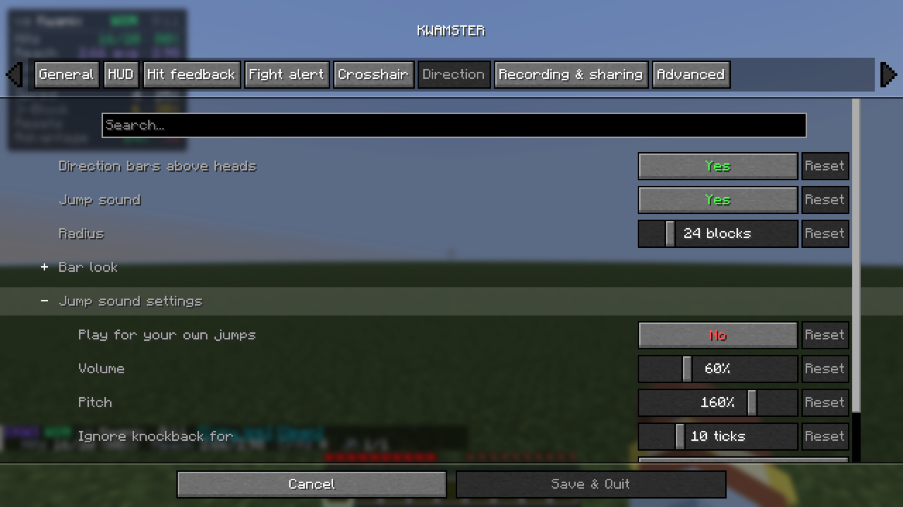<br><em>+ Jump sound settings</em></td>
  </tr>
</table>

**+ Bar look** (greyed out while the bars are off):

| Setting | Default | Choices | What it does |
|---|---|---|---|
| Show above yourself | No | Yes / No | Your own bar, visible only in third person (F5) |
| Moving forward | `#eb4cd964` | colour | Bar colour when the player moves the way they look |
| Moving backward | `#ebe03131` | colour | Bar colour when the player backpedals |
| Not moving | `#ebffd43b` | colour | Bar colour when the player stands still or strafes |
| Backdrop | `#8c000000` | colour | The dark frame behind the bar |
| Movement threshold | 0.020 b/t | 0.000 – 0.500 blocks per tick | Below this speed along their facing the bar reads as not moving (sneaking ≈ 0.065, walking ≈ 0.216, sprinting ≈ 0.280) |
| Width | 0.55 blocks | 0.05 – 3.00 | Width of the coloured bar |
| Height | 0.11 blocks | 0.02 – 1.00 | Height of the coloured bar |
| Height above head | 0.30 blocks | 0.00 – 3.00 | Gap between the top of the hitbox and the bar (the default sits between the head and the nametag) |

**+ Jump sound settings** (greyed out while the jump sound is off):

| Setting | Default | Choices | What it does |
|---|---|---|---|
| Play for your own jumps | No | Yes / No | Leave off to hear only other players jump |
| Volume | 60% | 0 – 200% | Cue volume, on vanilla's Players slider (above 100% stretches the hearing distance instead of getting louder) |
| Pitch | 160% | 50 – 200% | 100% is the cue's normal pitch |
| Ignore knockback for | 10 ticks | Off, 1 – 40 ticks | After a standing player is hit, their next launch is knockback, not a jump, for this long (cleared when they land) |
| ▶︎ Test | button | | Plays the cue with these values, including unsaved changes |

**+ HUD stoplight** (everything below the first switch is greyed out while the stoplight is off, which is the default):

| Setting | Default | Choices | What it does |
|---|---|---|---|
| Opponent stoplight | No | Yes / No | The [opponent stoplight](#opponent-stoplight-optional) on the HUD |
| Whose movement | Fight or aimed player | Current fight only / Fight or aimed player | Only your fight opponent, or outside a fight also the player you aim at |
| Approach/retreat threshold | 1.0 b/s | 0.3 – 4.0 b/s | Speed toward or away from you that switches to green or red |
| Hysteresis | 0.5 b/s | 0.0 – 2.0 b/s | Green or red holds until the speed drops this far below the threshold |
| Smoothing | 150 ms | Off, 1 – 600 ms | Averages the opponent's speed over about this long |
| Minimum hold | 150 ms | 0 – 600 ms | A light stays lit at least this long |
| Ignore knockback for | 300 ms | 0 – 1000 ms | After the opponent takes a hit, the light holds so knockback does not read as retreating |
| Aimed player range | 8 blocks | 3 – 16 blocks | Outside a fight, how far an aimed-at player can be |
| Style | Vertical | Vertical / Horizontal / Single light | Three lights stacked, three in a row, or one light |
| Show label and speed | No | Yes / No | `APPROACH`, `HOLD` or `RETREAT` and the speed beside the light |
| Hide when nobody is tracked | Yes | Yes / No | Off: the unlit light stays on screen at 40% |
| Approaching, Holding / strafing, Backing away, Unlit | `#ff2bd96b` / `#ffffc53d` / `#ffff4d4f` / `#ff2a2f37` | colours | The light colours |
| *Position stoplight…* | button | | Opens the HUD editor with the stoplight selected |

### Recording & sharing

<p align="center">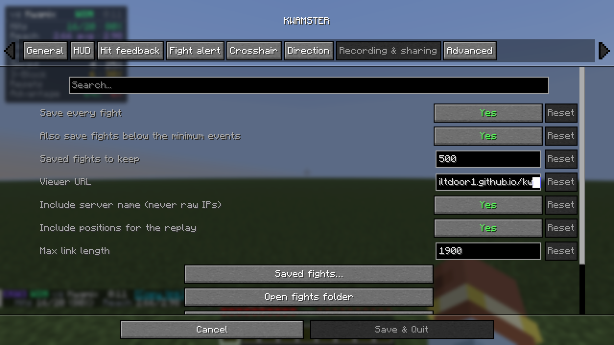</p>

| Setting | Default | Choices | What it does |
|---|---|---|---|
| Save every fight | Yes | Yes / No | Writes each finished fight to `config/kwamster/fights` |
| Also save fights below the minimum events | Yes | Yes / No | Also keep short draws with fewer events than Advanced → Minimum events (they never alert) |
| Saved fights to keep | 500 | 0 – 5000 (0 = unlimited) | Beyond this, the oldest unpinned fights are deleted (short ones first). Pinned fights are never deleted and do not count toward the limit |
| Viewer URL | `https://builtdoor1.github.io/kwamster/` | any http(s) address | The page share links open. Change it only if you [host the viewer yourself](#hosting-your-own-viewer) |
| Include server name (never raw IPs) | Yes | Yes / No | Puts the server's name in share links; numeric IP addresses are always left out |
| Include positions for the replay | Yes | Yes / No | Adds positions relative to where the fight started (never world coordinates) so the viewer can replay it |
| Max link length | 1900 | 600 – 8000 characters | Longer fights are thinned to fit; 1900 fits one Discord message |
| *Saved fights…* | button | | Opens the [Saved fights](#saved-fights) screen |
| *Open fights folder* | button | | Opens `config/kwamster/fights` in your file manager |
| *Copy last fight link* | button | | Copies the link of your most recent fight (after a restart, of the newest saved fight) |
| *Reset session stats* | button | | Clears this session's totals immediately |
| *Reset lifetime stats* | button | | Clears your lifetime totals (saved fight files are kept). Click twice within 4 s to confirm |

### Advanced

<p align="center">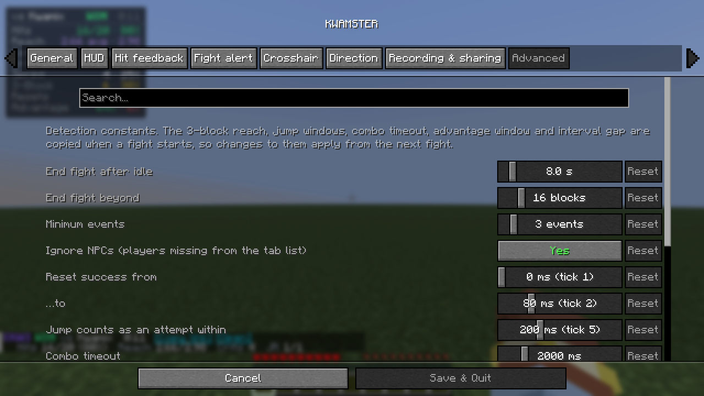</p>

Detection constants. The 3-block reach, jump windows, combo timeout, advantage window and interval gap are copied when a fight starts, so changes to them apply from the next fight.

| Setting | Default | Choices | What it does |
|---|---|---|---|
| End fight after idle | 8.0 s | 2.0 – 60.0 s | A fight ends when nobody lands, takes or swings a hit for longer than this |
| End fight beyond | 16 blocks | 6 – 64 blocks | A fight ends when your opponent is farther away than this |
| Minimum events | 3 | 1 – 20 | A draw with fewer swings plus hits taken raises no card or chat line and is left out of the totals. A win or loss always counts |
| Ignore NPCs (players missing from the tab list) | Yes | Yes / No | Hub NPCs that look like players never start a fight, count as targets or colour the crosshair |
| Reset success from | 0 ms (tick 1) | 0 – 100 ms | Earliest jump that counts as a successful reset (0 ms = the first tick after the hit, +50 ms per tick) |
| …to | 80 ms (tick 2) | 20 – 250 ms | Latest jump that counts as a successful reset |
| Jump counts as an attempt within | 200 ms (tick 5) | 100 – 400 ms | A jump this soon after a hit counts as an attempt; later jumps are ignored |
| Combo timeout | 2000 ms | Never, 1 – 10000 ms | A combo also ends when your next hit comes later than this |
| Advantage window | 3000 ms | 1000 – 10000 ms | How far back the advantage bar looks |
| Trade window | 400 ms | 100 – 1000 ms | A hit dealt and a hit taken this close together are a trade |
| Miss target range | 6 blocks | 3 – 10 blocks | A swing at the air counts as a miss against the nearest player within this range… |
| Miss target cone | 30° | 5° – 60° | …and within this angle of where you look |
| Interval max gap | 2000 ms | 500 – 5000 ms | Longer gaps are left out of the hit interval average |
| Spectator switch after a hit counts as a death within | 3000 ms | Off, 1 – 10000 ms | On servers that turn the loser into a spectator instead of killing them, a switch this soon after the last hit ends the fight as a win or loss |
| NO-REG immunity window | 10 ticks | Off, 1 – 20 ticks | A hit this soon after your last registered hit on the same player is NO-REG (vanilla: 10 ticks). Set 0 on combo servers with a reduced hit delay |

### Saving, cancelling and errors

- **Save & Quit** is clickable once something changed and nothing has an error. It applies the changes in game at once and writes `config/kwamster/config.json`. It never touches the HUD layout (that belongs to the HUD editor).
- **Cancel** (it reads **Discard Changes** once you changed something) or **Esc** throws the changes away, after a "Changes Not Saved" confirmation.
- A few buttons act **immediately** and are not undone by Cancel: Reset HUD layout, Reset session stats, Reset lifetime stats, Copy last fight link and Open fights folder, and pins and deletions in the Saved fights screen. In the HUD editor, **Done and Esc save**; only its Cancel button discards.
- **Errors** turn the field red, show the message at the top of the screen and disable Save: `Not a valid color!`, `Alpha must be at least 20 (hex), or the text would be invisible`, `The label cannot be empty`, `At most 16 characters (now N)`, `Enter a sound id, e.g. minecraft:block.note_block.pling`, `Not a valid sound id: lower-case namespace:path, e.g. minecraft:block.note_block.pling`, `Needs a full http(s) address with a host, e.g. https://example.com/kwamster/`, number limits on the two number fields, and on the Advanced tab `Reset success "to" must not be below "from"` and `The attempt window must not be shorter than the success window`. A greyed-out field never blocks Save.
- A sound id without a namespace (like `block.note_block.pling`) means `minecraft:`. Upper-case letters are not allowed in ids.
- The ▶︎ Test buttons play your unsaved values and ignore the Hit sounds and Sound switches, so you can audition a sound before turning it on. A tier's ▶︎ Test is greyed out only while that tier is switched off.

---

## Keybinds

All keys are under **Options → Controls → Key Binds → KWAMSTER** and can be rebound.

| Action | Default | What it does |
|---|---|---|
| Open settings | **K** | Opens the settings (works even with KWAMSTER switched off, so you can turn it back on) |
| Edit HUD layout | unbound | Opens the HUD editor |
| Toggle HUD | unbound | Hides or shows the five HUD elements, and says so in the action bar |
| Saved fights | unbound | Opens the Saved fights screen |
| Copy last fight link | unbound | Copies the share link of the last fight finished this session |
| Toggle custom crosshair | unbound | Switches between KWAMSTER's crosshair and vanilla's |

Screens open only when no other screen is open, so typing K in chat does nothing. With KWAMSTER switched off, only Open settings works.

---

## Compatibility

- **Sodium and Iris.** KWAMSTER does not touch chunk rendering. It draws its HUD through Fabric's HUD layer, the direction bars through Fabric's world render event (as Direction Indicator did), and only wraps vanilla's crosshair image, so it is built to run alongside Sodium and Iris, with shaders on or off.
- **Lunar Client.** Load it in the Fabric 1.21.11 profile and turn off Lunar's own Crosshair mod (see [Install](#install)). If another mod or client replaces the vanilla crosshair, the game still loads and everything except KWAMSTER's crosshair keeps working.
- **Other crosshair mods** behave the same way: turn theirs off, or turn KWAMSTER's off (Crosshair → Custom crosshair, or the Toggle custom crosshair key).
- **1.8-style servers** (ViaVersion, OldCombatMechanics and similar):
  - With no attack cooldown, almost every hit counts as charged, so weak hits are rare. Spam clicks into hurt immunity are flagged NO-REG, so they do not inflate combos or play sounds. Normal and weak hit sounds are off by default for the same reason.
  - Servers older than 1.19.4 reached through ViaVersion, ViaFabricPlus or ViaProxy send damage without saying who caused it. Until the server sends one damage event that does name a source, KWAMSTER infers it: the attacker is the nearest player within 4.5 blocks whose arm swing started in the last 2 ticks (your current opponent preferred), and your own hit counts as confirmed if you landed a registered hit on that player between roughly half your ping and your ping + 300 ms earlier (each hit confirms one damage event). While you are burning, poisoned or withered, whose damage ticks look exactly like hits on these servers, a hit taken also needs the knockback a real hit gives you. This is a heuristic: fall or cactus damage right after a nearby opponent swung can count as a hit taken, a real hit while you burn can be dropped if its knockback arrives a tick late, damage from a third player just before your hit can count as your confirmation, and a hit whose attacker's swing started more than 2 ticks earlier is dropped.
- **Combo servers with a reduced hit delay**: set Advanced → NO-REG immunity window to 0.
- **Servers that hide health**: damage dealt and taken show "—", and trades are counted but never won or lost (the panel shows `0W 0L`, the trade win rate reads "—"). Fights still end correctly; hidden health never reads as dead.
- **Practice servers without death events** (a kill just teleports both players): the fight usually ends as a DRAW because the opponent is suddenly far away or gone. A switch to spectator within 3 s of the last hit is treated as a death. If you are respawned in the same dimension without a death event, the fight ends as a DRAW (world change).
- **Hub NPCs** are ignored by the fight tracker (see [NPCs](#npcs-spears-and-other-exclusions)).
- **Singleplayer** works; paused time is not counted.

---

## Privacy and files

- No telemetry, no analytics, and no network code: KWAMSTER never opens a connection.
- The only thing that leaves the game is a share link, and only when you copy it to the clipboard or open it in your browser yourself.
- Everything is stored under `config/kwamster/` in your game folder:
  - `config.json`: your settings.
  - `fights/<id>.json`: one file per saved fight, and `fights/index.json`, the list behind the Saved fights screen.
  - `lifetime.json`: your lifetime totals.
- A file KWAMSTER cannot read is moved aside, never deleted: a broken fight file goes to `fights/broken/`, and a broken config or lifetime file is renamed to `config.broken-<time>.json` or `lifetime.broken-<time>.json` (the settings then start from the defaults).
- Saved fight files stay on your computer. They include player names, UUIDs and the server address you joined; share links do not include UUIDs or IP addresses.
- Turning **KWAMSTER enabled** off makes the game behave like vanilla: no HUD, custom crosshair, bars, sounds, chat lines or new files. A fight running at that moment is saved once, silently.

---

## Troubleshooting and FAQ

**Hits never register as landed.** Look in the game log for `Landed-hit hook active` after your first hit. If it is missing, another mod is changing vanilla's attack code; please [open an issue](https://github.com/builtdoor1/kwamster/issues) with your mod list.

**I hear no hit sounds.** Check Hit feedback → Hit sounds, the tier's own Sound switch, and the vanilla volume slider named in Hit feedback → Volume category (Players by default). The ▶︎ Test button warns when a slider is at 0%.

**Two crosshairs, or KWAMSTER's crosshair never shows.** Another crosshair mod, or Lunar's Crosshair mod, is drawing its own. Turn one of them off.

**Two panels or two settings screens.** Combat Tracker, Combat Report or Direction Indicator is still installed. Remove it ([why](#coming-from-combat-tracker-combat-report-or-direction-indicator)).

**My combos differ from Combat Tracker's.** Combat Tracker counted only sprint hits and ended a combo after a 0.7 s gap. KWAMSTER counts every registered hit, allows 2 s between hits (Advanced → Combo timeout), and leaves out NO-REG hits (clicks into hurt immunity, which do no damage), so a combo can read higher or lower. On combo servers with a reduced hit delay, set Advanced → NO-REG immunity window to 0.

**A share link says it could not be read.** Chat apps sometimes cut long links. Copy it again with [Copy link] in game and paste it whole, or lower Recording & sharing → Max link length.

**Every fight is a DRAW on my practice server.** That server skips death events; see [Compatibility](#compatibility).

**The panel covers the scoreboard.** Move it in the HUD editor; server information always draws over KWAMSTER.

**Where are my fights?** In `config/kwamster/fights/`. **Open folder** on the Saved fights screen opens it.

---

## Building from source

```bash
git clone https://github.com/builtdoor1/kwamster
cd kwamster
./gradlew build
```

The jar lands in `build/libs/kwamster-<version>+1.21.11.jar`. Requires Java 21.

```bash
./gradlew test                   # JUnit 5 tests of the Minecraft-free logic; also writes golden share-link vectors to build/share-vectors/
node tools/viewer-check.mjs      # after the tests (Node 21.2+): checks the viewer's JavaScript decoder against those vectors
./gradlew runClientGameTest      # starts a real client, plays scripted fights in a flat world, saves screenshots to build/run/clientGameTest/screenshots/
```

On Windows use `gradlew.bat` (or `.\gradlew`) instead of `./gradlew`. `./gradlew runClient -PmixinDebug` writes every patched class to `run/.mixin.out` for debugging.

The unit tests cover hit grading, aim zones, jump-reset timing, NO-REG detection, the stats calculator, fight start and end rules, the direction bars' movement and jump detection, the stoplight filter, the share-link codec and its size budget, the HUD layout and the crosshair shapes. The client gametest checks the HUD, crosshair, direction bar, stoplight, summary card, settings, HUD editor and saved-fights screen in game, and takes the in-game screenshots in this README.

[`DESIGN.md`](DESIGN.md) is the full technical design: every hook, formula and data format.

---

## Credits and license

KWAMSTER is made by **builtdoor**. It merges builtdoor's earlier Combat Tracker, Combat Report and Direction Indicator into one mod.

Released under the [MIT License](LICENSE). Built on Fabric API and Cloth Config, with Mod Menu integration.
