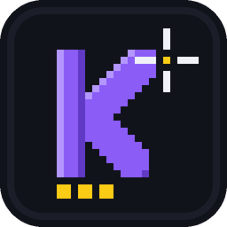
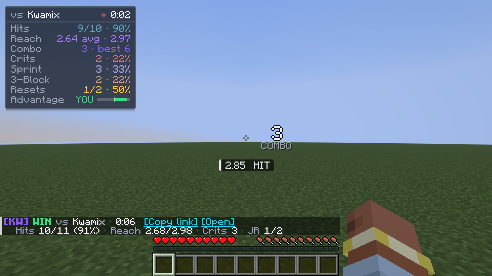
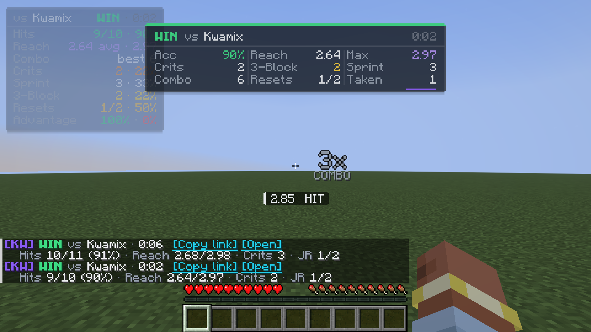
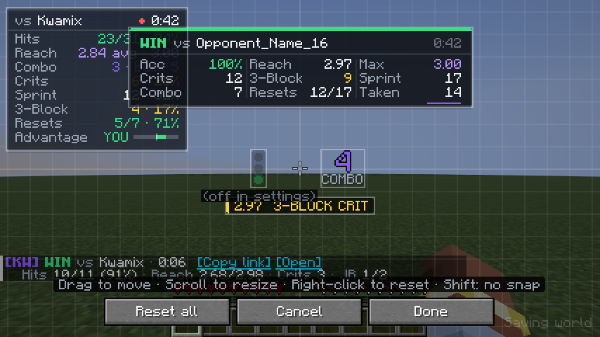
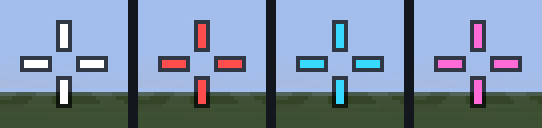
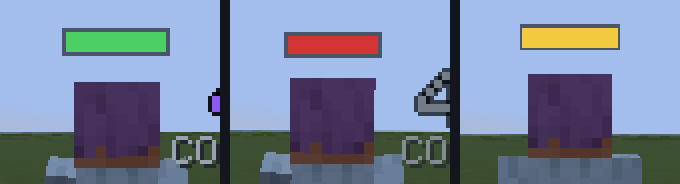
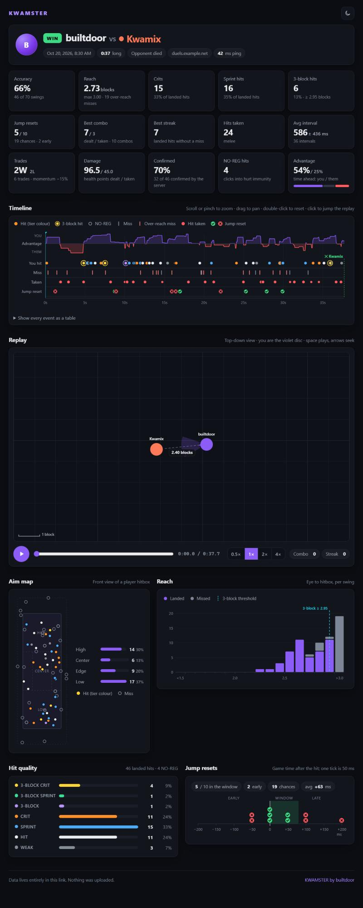
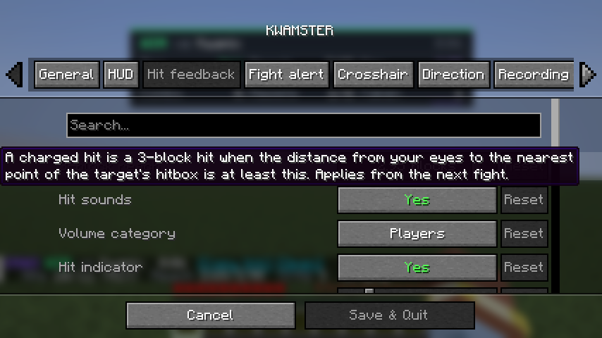
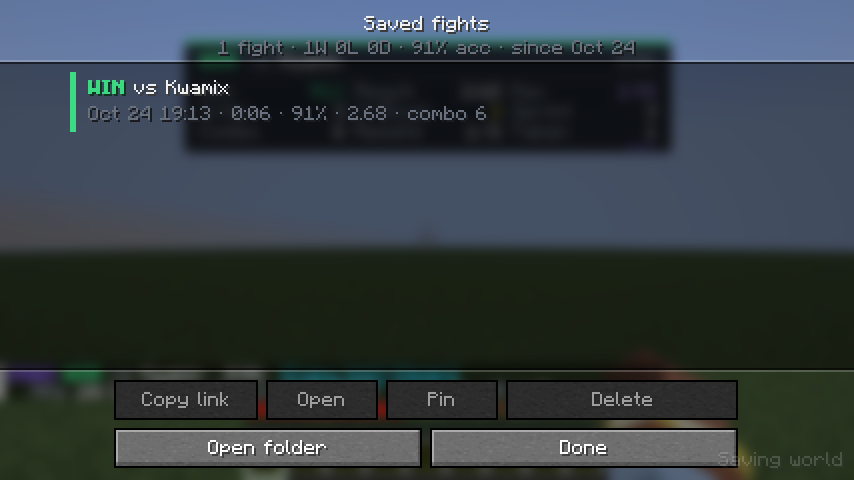

<p align="center">
  
</p>

<h1 align="center">KWAMSTER</h1>

<p align="center">
  A client-side PvP stats mod for Minecraft 1.21.11 (Fabric). It grades every hit, tracks reach, aim, combos and jump resets, and turns each fight into a link you can share.
</p>

<p align="center">
  <a href="https://github.com/builtdoor1/kwamster/releases">Releases</a> ·
  <a href="https://github.com/builtdoor1/kwamster/issues">Issues</a> ·
  <a href="https://builtdoor1.github.io/kwamster/">Fight viewer</a>
</p>

---

## Screenshots

<p align="center">
  
  <br><em>A fight in progress. Stats panel (top left), combo counter beside the crosshair, hit indicator below it. The chat lines are the summary of the previous fight.</em>
</p>

<p align="center">
  
  <br><em>The summary card after a win. The panel fades out behind it, the combo counter shows the final tally (3×), and the chat summary carries [Copy link] and [Open].</em>
</p>

<p align="center">
  
  <br><em>The HUD editor with preview data. The hit indicator shows a 3-block crit in its gold tier colour and the combo counter sits beside the crosshair; the optional stoplight is shown dimmed because it is off.</em>
</p>

<table>
  <tr>
    <td align="center"></td>
    <td align="center"></td>
  </tr>
  <tr>
    <td align="center"><em>Crosshair, left to right: default, on a player in reach, crit ready (falling), crit ready on a player.</em></td>
    <td align="center"><em>Direction bar above a player's head: moving forward, backpedalling, standing still.</em></td>
  </tr>
</table>

<table>
  <tr>
    <td align="center" valign="top"></td>
    <td align="center" valign="top">
      <br>
      <em>Settings (Cloth Config), Hit feedback tab.</em><br><br>
      <br>
      <em>Saved fights: copy or open a fight's link, pin it, delete it.</em>
    </td>
  </tr>
  <tr>
    <td align="center"><em>The web viewer: stat cards, timeline, top-down replay, aim map, reach histogram, hit quality and jump resets.</em></td>
    <td></td>
  </tr>
</table>

---

## Features

- **Jump resets.** Every melee hit you take on the ground is a chance. Jump on the first or second tick after the hit and it is a successful reset; later is late, before the hit is early. Decided in game ticks, so it does not depend on your FPS. Late presses count even after knockback has lifted you.
- **Reach, including misses.** Eye-to-hitbox distance for every hit, the same distance the server checks. Missed swings get a reach too (measured to the player you swung at), and misses beyond your attack range are flagged as over reach.
- **Aim placement.** Each landed hit is sorted into a zone of the target's hitbox: high, low, edge or centre.
- **Accuracy.** Landed hits out of swings at a player, plus how many of them the server confirmed.
- **Combo, streak and advantage.** Your hits in a row before the opponent hits back (and theirs on you), landed hits in a row without a miss, and a live bar showing who is winning the exchange.
- **Sprint hits.** Vanilla's extra-knockback hit: charged and sprinting.
- **Crits.** Vanilla's critical-hit rule, copied exactly, with the crit rate over all landed hits.
- **Hit timing and 3-block hits.** Average time between your hits (from the attack-key press, frame-accurate) and the "perfect" hits: charged hits landed from 2.95 blocks or farther (adjustable).
- **Hit-quality colours and sounds.** Every landed hit gets one of seven tiers, each with its own colour, label and vanilla sound:

  | Tier | Label | Colour | Default sound | Volume / pitch |
  |---|---|---|---|---|
  | 3-block crit | `3-BLOCK CRIT` | gold `#FFD43B` | `entity.experience_orb.pickup` | 80% / 120% |
  | 3-block sprint | `3-BLOCK SPRINT` | mint `#3DDC97` | `block.note_block.pling` | 70% / 150% |
  | 3-block hit | `3-BLOCK` | lavender `#B794F6` | `block.note_block.chime` | 60% / 140% |
  | Crit | `CRIT` | orange `#FF922B` | `block.note_block.bell` | 55% / 120% |
  | Sprint hit | `SPRINT` | blue `#4DABF7` | `block.note_block.hat` | 50% / 100% |
  | Normal hit | `HIT` | white `#E9ECEF` | `block.note_block.snare` (off by default) | 35% / 100% |
  | Weak hit | `WEAK` | grey `#868E96` | `block.note_block.bass` (off by default) | 40% / 60% |

  All ids are in the `minecraft:` namespace. Colour, label, sound id (any vanilla or resource-pack sound), volume and pitch are editable per tier, and each tier can be switched off. The only sound file in the mod is the jump cue.
- **Display modes.** Stats panel, chat, or both. Chat can print a summary after each fight, a line for every hit, both, or nothing. Between fights the panel shows your last fight, the session totals, or nothing.
- **Fight summary card.** A compact card with the result and nine key numbers when a fight ends.
- **Crosshair states.** A crisp custom crosshair (cross, T, X, circle or dot) that changes colour on a player in reach, when a crit is ready, and when both, and flashes the tier colour when you land a hit.
- **Direction bars.** The same bar Direction Indicator drew: a flat bar above every nearby player's head that is green when they move the way they are looking, red when they backpedal and yellow when they stand still or strafe.
- **Jump sound.** A short positional cue the moment a nearby player starts a jump, so you hear where they jumped. Knockback launches do not count.
- **Opponent stoplight (optional).** A small traffic light on the HUD for your fight opponent: green when they move toward you, yellow when they hold distance or strafe, red when they back away. Off by default; turn it on under Direction → HUD stoplight.
- **Saved fights.** Every fight is saved on your computer and listed in game, with lifetime and session totals.
- **Share links.** One click copies a link that opens the fight in a web viewer with a timeline and a top-down replay. The whole fight is inside the link; nothing is uploaded.

---

## Install

You need:

| | Version |
|---|---|
| Minecraft | 1.21.11 |
| [Fabric Loader](https://fabricmc.net/use/) | 0.19.3 or newer |
| [Fabric API](https://modrinth.com/mod/fabric-api) | 0.141.4 or newer (required) |
| [Cloth Config](https://modrinth.com/mod/cloth-config) | 21.11.153 or newer, Fabric build (required) |
| [Mod Menu](https://modrinth.com/mod/modmenu) | optional, adds a config button to the mod list |

1. Install Fabric Loader for 1.21.11.
2. Put `kwamster-<version>+1.21.11.jar` (for example `kwamster-1.0.0+1.21.11.jar`), Fabric API and Cloth Config in your `mods` folder.
3. Start the game and press **K** to open the settings.

If a required mod is missing, Fabric tells you which one when the game starts.

KWAMSTER is client-side only. The server does not need it, and it reads only what your client already receives. Check your server's rules on client mods.

**Lunar Client.** Use the Fabric 1.21.11 profile and drop the jar into that profile's mods folder (usually `.lunarclient/profiles/1.21/mods/fabric-1.21.11/` in your user folder), together with Fabric API and Cloth Config unless Lunar already provides them. Then **disable Lunar's own Crosshair mod**, otherwise its crosshair replaces or overlaps KWAMSTER's.

---

## Coming from Combat Tracker, Combat Report or Direction Indicator

KWAMSTER replaces all three; Direction Indicator's above-head bars and jump sound are built in with the same defaults. **Remove them from your mods folder** before installing it:

- They draw their own HUDs, so you would see duplicate panels and indicators.
- Combat Report also binds **K**, the same default key as KWAMSTER's settings, so one press would open two screens.

KWAMSTER declares them as conflicts, so Fabric Loader prints a warning at startup if one is still installed (the game still launches). KWAMSTER keeps its own data in `config/kwamster/` and does not read the other mods' files.

---

## Keybinds

All keys are under **Options → Controls → Key Binds → KWAMSTER** and can be rebound.

| Action | Default |
|---|---|
| Open settings | **K** |
| Edit HUD layout | unbound |
| Toggle HUD | unbound |
| Saved fights | unbound |
| Copy last fight link | unbound |
| Toggle custom crosshair | unbound |

- Screens open only when no other screen is open, so typing K in chat does nothing.
- With the master switch off, only Open settings works, so you can turn the mod back on in game.
- Toggle HUD and Toggle custom crosshair save the setting and confirm in the action bar. Copy last fight link puts the link on your clipboard and shows its length.

---

## How the numbers are defined

### What counts as a swing

A swing is an attack click that passes vanilla's own attack checks, made while you are not a spectator, and aimed at a player:

- If your crosshair is on a player, the swing targets them.
- If it is on nothing or a block, the swing counts as a **miss** against the living player nearest your crosshair within a 30° cone and 6 blocks (Advanced → Miss target cone / range). With nobody there, the swing is ignored.
- Clicks on mobs, end crystals, armour stands, NPCs or a body that just died are not counted at all.
- Clicks during the attack cooldown are real swings; if they land they are weak hits.

**Landed** means your client actually sent the attack. **Accuracy** = landed / swings. **Confirmed** means the server sent back a damage event for that hit (matched within your ping + 300 ms); it is shown in the chat hover and the viewer.

### Reach

- Reach = distance from your eyes to the **nearest point of the target's hitbox** at the moment you attack, measured on tick positions. This is the distance the server checks.
- With vanilla attributes, landed reach is always below 3.00, because the client only picks a player inside 3 blocks.
- Missed swings record the same distance to the player you swung at. A miss farther than your attack range (3.0 in vanilla) is **over reach** (shown with ↑).
- Displayed reach is **rounded down** to two decimals everywhere, so a shown 2.95 really is at least 2.95. The one exception is an over-reach miss: it always reads at least 0.01 above your range (a 3.004-block miss shows `MISS 3.01 (over reach)`, never 3.00).
- If a server gives an item its own attack range, reach is still recorded but the hit is never graded as a 3-block hit.

### Hit tiers

Each landed hit gets the first tier that matches:

1. Not charged (attack cooldown at 90% or less): **WEAK**.
2. A **crit** that is also a 3-block hit: **3-BLOCK CRIT**, otherwise **CRIT**.
3. A **sprint hit** that is also a 3-block hit: **3-BLOCK SPRINT**, otherwise **SPRINT**.
4. Any other charged hit (plain hits and sweeps): **3-BLOCK** or **HIT**.

- **3-block hit** ("perfect" hit) = a charged hit with reach **≥ 2.95 blocks**, eye to nearest hitbox point. Adjustable from 2.50 to 3.00 under Hit feedback → 3-block reach.
- **Sprint hit** = **charged and sprinting** at the moment of the hit, the hit vanilla gives extra knockback. An uncharged hit while sprinting is not a sprint hit, so spam-clicking while sprinting does not inflate the count. Sprint % = sprint hits / landed hits.
- **Crit** = charged and vanilla's crit condition, verbatim: falling (fall distance above 0), not on the ground, not on a ladder or vine, not in water, not blinded, not riding anything, not sprinting. Because a crit needs "not sprinting", a hit is never both a crit and a sprint hit.
- **Crit rate** = crits / **all landed hits**, weak hits included: of the hits you landed, how many were crits.
- **3-block %** = 3-block hits / landed hits.

### NO-REG hits

A landed hit is flagged **NO-REG** when the target is most likely still in hurt immunity, so the server ignores it:

- fewer than **10 ticks** (0.5 s) after your last registered hit on the same player, or
- while that player is still immune from someone else's damage (estimated from their hurt timer and your ping).

A landed hit that is not NO-REG is called a **registered** hit below.

NO-REG hits **count** for swings, landed, accuracy, reach, aim, tiers, crits and sprint hits. They **do not** add to or break your combo or streak, are left out of hit intervals and the advantage bar, play **no sound**, give no crosshair flash, and show a grey `NO-REG` indicator. The window is **Advanced → NO-REG immunity window** (0 to 20 ticks, default 10). Set it to 0 (off) on combo servers with a reduced hit delay.

### Jump resets

- A **chance** is a melee hit you take **while on the ground**. Hits taken in the air open no window (they cannot be reset). Bow, crossbow, trident, snowball, egg, wind charge and fishing-rod hits, and thorns, never count.
- An **attempt** is a jump (or a jump-key press) up to **200 ms** of game time (5 ticks) after a chance, or up to 200 ms **before** a hit (an early attempt).
- Pressing jump just before you land and **holding** it is the classic timing: the game jumps on your first tick on the ground, so if the hit lands right then it counts as the jump it makes (a success), not as an early press. A press you let go of before the hit, or before that first tick, is early.
- Timing is counted in client ticks, one tick = 50 ms of game time, where **0 ms = the first tick after the hit**:

  | When you jump | Result |
  |---|---|
  | Tick 1 or 2 after the hit (0 or 50 ms) | success |
  | Tick 3 to 5 (100 to 200 ms) | late |
  | Before the hit landed | early |

- Jump % = successes / attempts. The panel shows `5/7 · 71%`; the chat hover and the viewer add chances and early attempts.
- The windows are Advanced → Reset success from / …to (default 0 to 80 ms) and Jump counts as an attempt within (default 200 ms). Because they are game ticks, results are the same at 60 and 240 FPS.

### Combo, streak and advantage

- **Combo** = your registered hits in a row before the opponent lands a melee hit on you. It also ends when your next hit comes more than **2 s** after the last one (Advanced → Combo timeout, 0 = never) and when the fight ends. Best combo is the longest; a "combo" in the counts is a chain of 2 or more. The same is tracked for hits you take in a row.
- **Streak** = landed hits in a row without a missed swing. Hits you take do not break it.
- **Advantage** looks at the last **3 s** (Advanced → Advantage window). With d = your registered hits and k = melee hits you took in that window: exchange = (d − k) / max(d + k, 1). A combo term adds min(your combo, 3)/3 when you hold a combo and they do not (or subtracts the same for theirs). Advantage = ½ · combo term + ½ · exchange, from −1 to +1. The label reads **YOU** at +0.15 or more, **THEM** at −0.15 or less, else **EVEN**. After a fight it becomes the share of time (sampled every 100 ms) that each side was ahead.

### Aim zones

The hit point is where your crosshair ray entered the target's hitbox, using the hitbox's real pose (shorter when sneaking, crawling or swimming). One zone per landed hit, first match wins:

- **High**: top third of the hitbox height.
- **Low**: bottom third.
- **Edge**: the outer quarter of the width on either side.
- **Centre**: everything else.

### Hit timing

Interval = time between two consecutive registered hits on the same opponent, measured from your attack-key press (frame-accurate) when one was seen within 200 ms of the attack. Gaps over 2 s (Advanced → Interval max gap) are left out. Shown as average ± standard deviation.

### Fights

- **Start**: your first swing at a player (landed or missed) or the first melee hit you take, while no fight is running.
- **Engaged opponent**: a player you landed a hit on or who hit you in melee. A player you only whiffed at is not engaged.
- **Keep-alive**: swings, hits and hits taken keep the fight going. Arrows and other projectile hits from an engaged opponent, your own projectile hits on them, and spear stabs at them keep it alive too, but never start a fight.
- **End and result**:

  | Fight ends when | Result |
  |---|---|
  | An engaged opponent dies | WIN |
  | You die | LOSS |
  | An engaged opponent switches to spectator within 3 s of your last hit | WIN |
  | You switch to spectator within 3 s of the last hit you took | LOSS |
  | The opponent leaves, is no longer tracked, or turns spectator later | DRAW |
  | The opponent is more than 16 blocks away | DRAW |
  | 8 s pass with no combat | DRAW |
  | You disconnect, change world or dimension, or respawn | DRAW |
  | You close the game, or turn KWAMSTER off mid-fight | DRAW |

  The 3 s, 16 block and 8 s values are Advanced settings. If both players die, the first death seen decides. If a bystander you only whiffed at dies to someone else, the fight ends as a DRAW, never a WIN.
- **Duration** runs from the first event to the last combat event (or the death), so idle time at the end is not counted. Singleplayer pauses are excluded.
- **Card and chat**: a fight raises the summary card and chat summary when it has at least **3** swings plus melee hits taken (Advanced → Minimum events), or when it is a WIN or LOSS. Shorter draws are still saved (unless you turn that off) but are not announced and are not added to session or lifetime totals. A fight that ends because you disconnected is saved without a card or chat line.
- **Several opponents**: a 1v2 is one fight. Stats cover everyone; the primary opponent is the engaged one you exchanged the most hits with.
- **Settings snapshot**: the 3-block reach, jump windows, combo timeout, advantage window and interval gap are copied when a fight starts, so changing them applies from the next fight.

### Direction bars and the jump sound

These work exactly like Direction Indicator:

- **Which way.** Each player's movement over the last tick is measured against the direction they are looking, smoothed so a dropped position update cannot flicker the colour. Forward is green, backward red; below 0.020 blocks per tick along their facing (Bar look → Movement threshold) the bar is yellow, so strafing reads yellow. Teleports of more than 4 blocks count as no movement.
- **Who.** Every player within 24 blocks (Direction → Radius), alive and not spectating. Your own bar is off by default and only visible in third person.
- **Where.** Just above the head and below the nametag, always facing you, drawn behind terrain rather than through it. Hidden with F1.
- **Jumps.** A jump counts once a player has left the ground and gained 0.1 blocks of height within 4 ticks, so stepping off a ledge never counts, and a cue cannot repeat within 6 ticks. The cue plays from that player's position, so you hear where they jumped, and by default not for your own jumps.
- **Knockback.** A hit on a standing player launches them almost exactly like a jump, so their next launch within 10 ticks (Jump sound settings → Ignore knockback for) is ignored; landing clears it. A jump made on the very tick of a hit, a jump reset, looks the same as knockback and is ignored too. Launches that deal no damage, such as wind charges and fishing rods, still play the cue.

### NPCs, spears and other exclusions

- **NPCs**: a player missing from the tab list, or with a version-2 UUID (used by Citizens and most NPC plugins), is treated like a mob: never a target, attacker or fight. This stops hub queue NPCs from creating fights. Turn it off under Advanced → Ignore NPCs if a server hides real players from the tab list.
- **Spears**: spear attacks are counted separately and kept out of swings, accuracy, reach and tiers, because the client never learns whether a stab landed. They still keep a fight alive.
- **Thorns** is ignored both ways.
- **Damage dealt and taken** are filled in only when the server shows health (health drops from 0.1 s before to 0.9 s after a hit). Otherwise they show "—".

---

## Share links

After a fight, click **[Copy link]** or **[Open]** in the chat summary, or use the Saved fights screen, the Copy last fight link key, or the button under Recording & sharing.

**What a link contains**

- Your name and your opponents' names (up to four).
- The server name, if Include server name is on. Numeric IP addresses are always left out.
- When the fight started (to the second), its duration, result and end reason, and your ping.
- The thresholds used: 3-block reach, jump windows, combo timeout and advantage window.
- The summary numbers (exact).
- A list of events: time, hit, miss, hit taken, jump or death, reach, aim offset, tier, NO-REG flag and jump timing.
- If Include positions is on: your position relative to where the fight started, and each opponent's direction and distance from you, for the replay.

**What it never contains**: world coordinates, IP addresses, UUIDs, or anything outside the fight.

**Nothing is uploaded.** The fight is compressed into the part of the link after `#`. Browsers never send that part to any server, and the viewer page is a single self-contained file that makes no network requests (no fonts, no player heads, no analytics). It unpacks the link in your browser.

Links are kept within **1900 characters** by default (one Discord message; Recording & sharing → Max link length, 600 to 8000). For long fights the event list is thinned to fit; the summary numbers stay exact, and the viewer says how many events the replay shows.

**Browser support**: Chrome or Edge 103+, Firefox 113+, Safari 16.4+, phones included. Older browsers get a message instead of a broken page.

**Hosting your own viewer**

Links open the page set in **Recording & sharing → Viewer URL** (default `https://builtdoor1.github.io/kwamster/`). The viewer is the single file [`docs/index.html`](docs/index.html), so any static host works. With GitHub:

1. Fork this repository.
2. In your fork, go to **Settings → Pages**, choose **Deploy from a branch**, branch `main`, folder `/docs`, and save.
3. Set Viewer URL to your Pages address, for example `https://<you>.github.io/kwamster/`.

A trailing `/` is added unless the URL ends in a file name or has a query. Links you shared earlier keep pointing at the address they were made with, and work only while that site serves the viewer.

---

## Settings tour

Open the settings with **K**, or through Mod Menu. Every setting has a tooltip and a reset button.

| Tab | What is there |
|---|---|
| General | Master switch, hide all HUD elements, hide the HUD while F3 is open. Stats output (HUD only / Chat only / HUD + chat), Chat output (Off / After each fight / Every hit / Both), summary lines (1 to 3), the [Copy link] [Open] buttons, and per-hit miss and jump-reset lines. |
| HUD | What the panel shows between fights, compact panel, which of the 14 panel rows to show, the combo counter and when it appears, value flash, colours. Edit HUD layout… and Reset HUD layout. |
| Hit feedback | 3-block reach, hit sounds, volume category (Master, Players or UI), the hit indicator. One section per tier: on/off, colour, label, sound on/off, sound id, volume, pitch, and a ▶ Test button that plays your unsaved values. |
| Fight alert | Summary card on/off, how long it shows (default 7 s), fade-out, footer hint. Position card… |
| Crosshair | Custom crosshair on/off, shape, arm length, gap, thickness, outline, centre dot, scale with GUI scale, keep or hide vanilla's attack indicator, the four state colours, mobs as targets, hit flash and its duration. |
| Direction | Direction bars on/off, jump sound on/off, radius (24 blocks, shared). **Bar look:** show above yourself (F5), the three colours and the backdrop, movement threshold, width, height, height above head. **Jump sound settings:** play for your own jumps, volume, pitch, ignore knockback for, ▶ Test. **HUD stoplight** (off by default): whose movement (current fight only, or also the player you aim at), approach/retreat threshold, hysteresis, smoothing, minimum hold, ignore knockback for, aimed player range, style (vertical, horizontal, single light), label and speed, hide when nobody is tracked, colours, Position stoplight… |
| Recording & sharing | Save every fight, also save short fights, saved fights to keep (default 500, 0 = unlimited, pinned fights are never deleted; short fights are deleted first and never push out a real one), Viewer URL, include server name, include positions, max link length. Saved fights…, Open fights folder, Copy last fight link, Reset session stats, Reset lifetime stats (click twice). |
| Advanced | Detection constants: idle end (8 s), distance end (16 blocks), minimum events (3), ignore NPCs, jump-reset windows, combo timeout (2 s), advantage window (3 s), trade window, miss target range and cone, interval max gap, spectator-switch death window (3 s), NO-REG immunity window (10 ticks). |

**HUD editor** (Edit HUD layout…, Position card…, Position stoplight…, or the Edit HUD layout key):

- **Drag** an element to move it. It snaps to screen margins, the centre line and other elements; hold **Shift** while dragging for no snap.
- **Scroll** over an element to resize it (0.5× to 3×, in steps that keep text crisp); **Shift + scroll** for fine steps.
- **Right-click** an element to reset it to its default place and size.
- Arrow keys nudge the selected element by 1 px (10 px with Shift), **R** resets it, **G** toggles the grid, **Tab** cycles the selection.
- **Done** or Esc saves, **Cancel** throws away your changes, **Reset all** (click twice) restores every default.

Elements stay anchored to their nearest screen edge or centre, so they keep their place when you change the GUI scale. Boss bars, the scoreboard sidebar, titles and chat always draw over KWAMSTER, so server information is never hidden; if a server uses them where an element sits, move the element in the editor.

---

## Compatibility

- **Sodium and Iris.** KWAMSTER does not touch chunk rendering. It draws its HUD through Fabric's HUD layer, the direction bars through Fabric's world render event (as Direction Indicator did), and only wraps vanilla's crosshair sprite calls, so it is built to run alongside Sodium and Iris, with shaders on or off.
- **Lunar Client.** Load it in the Fabric 1.21.11 profile and disable Lunar's own Crosshair mod (see [Install](#install)). If another mod or client replaces the vanilla crosshair, the game still loads and everything except KWAMSTER's crosshair keeps working.
- **Other crosshair mods** behave the same way: turn theirs off, or turn KWAMSTER's off (Crosshair → Custom crosshair, or the Toggle custom crosshair key).
- **1.8-style servers** (ViaVersion, OldCombatMechanics and similar):
  - With no attack cooldown, almost every hit counts as charged, so weak hits are rare. Spam clicks into hurt immunity are flagged NO-REG, so they do not inflate combos or play sounds. Normal and weak hit sounds are off by default for the same reason.
  - Servers older than 1.19.4 reached through ViaVersion, ViaFabricPlus or ViaProxy send damage without saying who caused it. Until the server sends one damage event that does name a source, KWAMSTER infers it: the attacker is the nearest player within 4.5 blocks whose arm swing started in the last 2 ticks (your current opponent preferred), and your own hit counts as confirmed if you landed a hit on that player that was not NO-REG between roughly half your ping and your ping + 300 ms earlier (each hit confirms one damage event). While you are burning, poisoned or withered, whose damage ticks look exactly like hits on these servers, a hit taken also needs the knockback a real hit gives you. This is a heuristic: fall or cactus damage right after a nearby opponent swung can count as a hit taken, a real hit while you burn can be dropped if its knockback arrives a tick late, damage from a third player just before your hit can count as your confirmation, and a hit whose attacker's swing started more than 2 ticks earlier is dropped.
- **Combo servers with a reduced hit delay**: set Advanced → NO-REG immunity window to 0.
- **Servers that hide health**: damage dealt and taken and trade results show "—". Fights still end correctly; hidden health never reads as dead.
- **Practice servers without death events** (a kill just teleports both players): the fight usually ends as a DRAW because the opponent is suddenly far away or gone. A switch to spectator within 3 s of the last hit is treated as a death. If you are respawned in the same dimension without a death event, the fight ends as a DRAW (world change).
- **Hub NPCs** are ignored (see [NPCs](#npcs-spears-and-other-exclusions)).
- **Singleplayer** works; paused time is not counted.

**Troubleshooting.** If hits never register as landed, look in the game log for `Landed-hit hook active` after your first hit. If it is missing, another mod is changing vanilla's attack code; please open an issue with your mod list.

---

## Privacy

- No telemetry, no analytics, and no network code: KWAMSTER never opens a connection.
- The only thing that leaves the game is a share link, and only when you copy it to the clipboard or open it in your browser yourself.
- Everything is stored under `config/kwamster/` in your game folder:
  - `config.json`: your settings.
  - `fights/<id>.json`: one file per saved fight, and `fights/index.json`, the list behind the Saved fights screen.
  - `lifetime.json`: your lifetime totals.
- Saved fight files stay on your computer. They include player names, UUIDs and the server address you joined; share links do not include UUIDs or IP addresses.
- Turning the master switch off makes the game behave like vanilla: no HUD, custom crosshair, sounds, chat lines or new files. A fight running at that moment is saved once, silently.

---

## Building from source

You need a Java 21 JDK. Node.js 21.2 or newer is needed only for the viewer check.

```sh
./gradlew build                  # compiles, runs the unit tests, writes build/libs/kwamster-<version>+1.21.11.jar
./gradlew test                   # JUnit 5 tests of the Minecraft-free logic; also writes golden share-link vectors to build/share-vectors/
node tools/viewer-check.mjs      # after the tests: checks the viewer's JavaScript decoder against those vectors
./gradlew runClientGameTest      # starts a real client, plays a scripted fight in a flat world, saves screenshots to build/run/clientGameTest/screenshots/
```

On Windows use `gradlew.bat` (or `.\gradlew`) instead of `./gradlew`. `./gradlew runClient -PmixinDebug` writes every patched class to `run/.mixin.out` for debugging.

The unit tests cover hit grading, aim zones, jump-reset timing, NO-REG detection, the stats calculator, fight start and end rules, the direction bars' movement and jump detection, the stoplight filter, the share-link codec and its size budget, the HUD layout and the crosshair shapes. The client gametest checks the HUD, crosshair, direction bar, stoplight, summary card, settings, HUD editor and saved-fights screen in game.

---

## Credits and license

KWAMSTER is made by **builtdoor**. It merges builtdoor's earlier Combat Tracker, Combat Report and Direction Indicator into one mod.

Released under the [MIT License](LICENSE). Built on Fabric API and Cloth Config, with Mod Menu integration.
